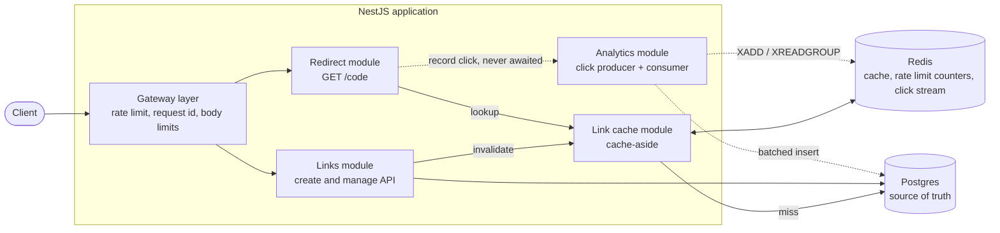
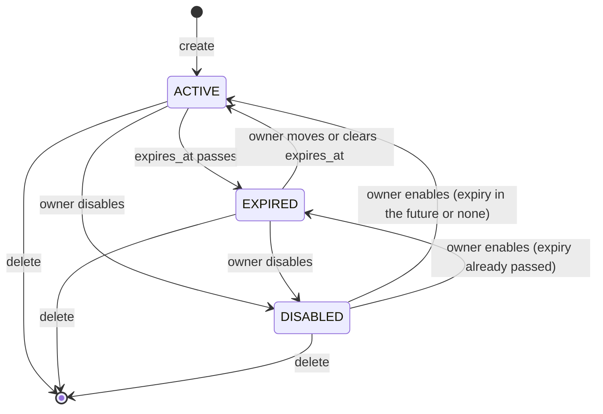
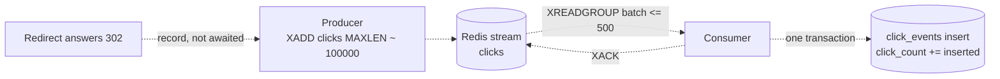
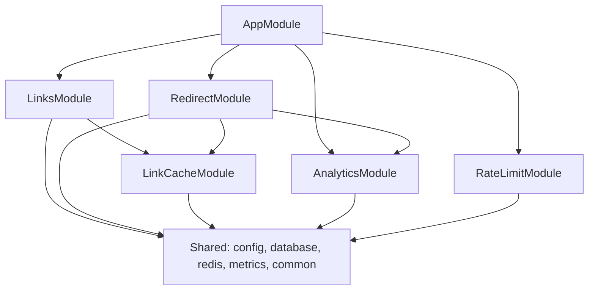

# URL Shortener MVP - Product Requirements Document

| | |
|---|---|
| Status | Approved for build (phase 1: PRD + foundation, phase 2: three parallel workstreams) |
| Source design | "URL Shortener System Design" whiteboard diagram, sections A-L |
| Stack | TypeScript, NestJS, PostgreSQL, Redis, Docker Compose |

## 1. Problem

Long URLs are awkward to share, impossible to change after they are shared, and tell the sharer nothing about whether anyone clicked.
A URL shortener turns `https://example.com/very/long/path` into `https://sho.rt/aB92xK7`, redirects every click in a few milliseconds, and lets the owner expire, edit, disable, and measure the link afterwards.

The workload is lopsided, and the design follows from that: links are created rarely and validated carefully, but they are clicked constantly, so the redirect path must be fast, cheap, and available even when the rest of the system is degraded.

## 2. Goals and non-goals

### Goals

1. Create a short link for a valid long URL through a JSON API.
2. Redirect `GET /{code}` with a `302` through a Redis cache-aside read path, with Postgres as the source of truth.
3. Honour link state on every click: unknown codes return `404`, expired or disabled links return `410`, and a warm cache never keeps a dead link alive.
4. Let the owner of a link read, edit, disable, and delete it.
5. Protect the service with rate limits and basic destination checks.
6. Record click analytics asynchronously, so that analytics can never slow down or break a redirect.
7. Run the whole system with one command: `docker compose up`.

### Non-goals

- Analytics at Kafka / ClickHouse scale, and any dashboard UI.
- User accounts, sign-up, OAuth, or an API key management UI. Owners are identified by pre-provisioned API keys.
- A web front end. The product is the HTTP API and the redirect.
- Multi-region deployment, CDN / edge caching, sharded Redis, database partitioning, or read replicas.
- Reputation services, malware scanning, CAPTCHA, abuse report workflows, or operator takedown tooling.

Section 16 lists the full MVP boundary against the diagram.

## 3. Users

| User | What they do | Diagram |
|---|---|---|
| Visitor (anyone with a browser) | Clicks a short link and expects to land on the destination immediately. Never authenticates. | A, F |
| Anonymous creator | Creates a link without credentials. The link always expires and can never be edited. | A, B |
| Link owner (API key holder) | Creates links, optionally with a custom alias, then edits, disables, deletes them and reads their click stats. | A, B, G, H |
| Operator | Runs the stack, watches health and metrics, tunes limits through configuration. | J, K |

## 4. Architecture



The diagram draws a separate API gateway, URL service, and redirect service.
The MVP runs them as modules of one stateless NestJS process, with the gateway concerns (rate limiting, request id, body and header limits) implemented as global middleware and guards.
Module boundaries match the diagram's service boundaries and depend on each other in one direction only, so the redirect path can be split into its own deployable later without a rewrite.

## 5. Functional requirements

Each requirement is tagged with the diagram section it comes from and whether it is in the MVP.
Requirement ids are stable and are referenced by the acceptance criteria and the work split.

### A. Clients and entry

| Id | Requirement | MVP |
|---|---|---|
| A-1 | Three public operations: `POST /api/v1/urls` (create), `GET /{code}` (redirect), `PATCH` / `DELETE /api/v1/urls/{code}` (manage). | Yes |
| A-2 | Gateway layer applies per-IP and per-key rate limits and answers `429` when exceeded. | Yes |
| A-3 | Every request gets a `request_id` (accepted from `X-Request-Id` or generated), echoed in the response header and present in every log line. | Yes |
| A-4 | Request bodies are capped at 10 kB; a larger body is refused with `413`. | Yes |
| A-5 | `/api/*` authenticates with an API key; `GET /{code}` needs no authentication. | Yes |
| A-6 | DNS / geo routing, CDN and TLS termination, L7 load balancing. | No - infrastructure outside the app |

### B. URL creation - write path

| Id | Requirement | MVP |
|---|---|---|
| B-1 | `POST /api/v1/urls` validates, generates or accepts a code, persists the mapping, clears the cache key, and answers `201` with the short URL. | Yes |
| B-2 | The long URL must parse as an absolute URL, use `http` or `https`, have a host, and be at most 2,048 characters. It is stored in normalised form (lowercase scheme and host). Violations return `400`. | Yes |
| B-3 | Custom alias: 3-32 characters of `[A-Za-z0-9_-]`, not a reserved word, only for authenticated callers. A taken alias returns `409`; a reserved alias returns `422`. | Yes |
| B-4 | Expiry policy: authenticated links may never expire (`expiresAt: null`). Anonymous links always expire, at most 365 days out, defaulting to 365 days. An expiry beyond policy returns `422`; an expiry in the past returns `400`. | Yes |
| B-5 | The owner of a link is the authenticated caller, otherwise `owner_id` is `NULL` (anonymous, read-only forever). | Yes |
| B-6 | A blocked destination returns `422` (see section I). | Yes |

### C. Short-code generation

| Id | Requirement | MVP |
|---|---|---|
| C-1 | Generated codes are 7 Base62 characters drawn from a CSPRNG (see section 8 for the choice and its justification). | Yes |
| C-2 | The `UNIQUE` constraint on `short_code` is the only uniqueness guarantee. The service never does `SELECT` then `INSERT`. | Yes |
| C-3 | On a unique violation for a generated code, retry with a fresh code, at most 5 attempts in total, then answer `503`. Collisions and retries are counted in metrics. | Yes |
| C-4 | Custom aliases share the same column and constraint; a unique violation for an alias is a `409`, never a retry. | Yes |
| C-5 | Generated codes that equal a reserved word are discarded and regenerated. | Yes |

### D. Redis cache

| Id | Requirement | MVP |
|---|---|---|
| D-1 | Cache-aside: read Redis, on a miss read Postgres and populate Redis. | Yes |
| D-2 | Entries carry `status` and `expiresAt`, and both are re-checked on every hit. | Yes |
| D-3 | Entry TTL is `min(1 hour, time until expiry)`. Unknown codes are negatively cached for 60 seconds. | Yes |
| D-4 | The write path deletes the cache key after every create, update, disable, and delete. | Yes |
| D-5 | Stampede protection: concurrent misses for the same code in one process share a single database read (single-flight). | Yes |
| D-6 | Losing Redis makes redirects slower, never wrong: the read path falls back to Postgres. | Yes |
| D-7 | In-process LRU for hot keys, sharded cluster, replicas, CDN purge. | No |

### E. URL mapping database

| Id | Requirement | MVP |
|---|---|---|
| E-1 | Postgres table `url_mappings` is the source of truth (section 7). | Yes |
| E-2 | Lookup by `short_code` is a unique index point lookup. | Yes |
| E-3 | Click events live in their own table and never touch the redirect lookup. | Yes |
| E-4 | Hash partitioning, replication, a "my links" listing and its `owner_id` index. | No |

### F. Redirect - read path

| Id | Requirement | MVP |
|---|---|---|
| F-1 | `GET /{code}` answers `302 Found` with `Location: <long URL>` and `Cache-Control: no-store`. | Yes |
| F-2 | `302`, not `301`: every click must come back to us so that edits, expiry, disabling and analytics stay under our control. | Yes |
| F-3 | Unknown code, or a code that is not shaped like a code: `404`. | Yes |
| F-4 | Disabled link: `410`. Expired link: `410`. Disabled wins when both apply. | Yes |
| F-5 | A cache hit is validated exactly like a database row (D-2). | Yes |
| F-6 | Cache hit: one Redis round trip and no database access. | Yes |
| F-7 | When neither Redis nor Postgres can answer, respond `503`. No unbounded retries. | Yes |

### G. Expiration and link management

| Id | Requirement | MVP |
|---|---|---|
| G-1 | `GET /api/v1/urls/{code}` returns the link to its owner. | Yes |
| G-2 | `PATCH /api/v1/urls/{code}` lets the owner change `longUrl`, `expiresAt`, and `status` (`ACTIVE` / `DISABLED`). A changed destination goes through the same validation and risk check as a new one. | Yes |
| G-3 | `DELETE /api/v1/urls/{code}` removes the link and its click events. The code then returns `404`. | Yes |
| G-4 | Every management write deletes the cache key after the database commit. | Yes |
| G-5 | Only the owner may manage a link: no credentials `401`, wrong owner or an anonymous link `403`. | Yes |
| G-6 | Expiry is enforced at redirect time from `expires_at`. Correctness never depends on a background job. | Yes |
| G-7 | Expiry worker that batch-marks expired rows and purges their keys. | No |

### H. Async analytics pipeline

| Id | Requirement | MVP |
|---|---|---|
| H-1 | Each successful redirect produces one click event without being awaited by the response. | Yes |
| H-2 | Producer failures (Redis down, stream full) drop the event and count the drop. They never fail or delay the redirect. | Yes |
| H-3 | Events flow through a Redis stream to an in-process consumer that batch-inserts into `click_events` (section 10). | Yes |
| H-4 | Delivery is at-least-once; duplicates are removed by a unique `event_id`. | Yes |
| H-5 | No raw IP address and no full referrer URL is stored: only referrer host and a coarse user-agent class. | Yes |
| H-6 | `GET /api/v1/urls/{code}/stats` returns total clicks and a per-day series to the owner. | Yes |
| H-7 | Kafka / Kinesis, ClickHouse / BigQuery, unique visitor estimates, geo and device breakdowns, dashboard. | No |

### I. Abuse prevention and security

| Id | Requirement | MVP |
|---|---|---|
| I-1 | Rate limit creation per IP and per API key (section 10). | Yes |
| I-2 | Synchronous risk check on create and on destination edits. Rejected with `422` when the host is on the configured blocklist (`BLOCKED_HOSTS`, exact host or any subdomain), is the shortener's own host (redirect loop), or is `localhost` or a private, loopback, or link-local IP literal. | Yes |
| I-3 | Authentication and owner-only authorisation on link management (G-5). | Yes |
| I-4 | Reserved words (`api`, `health`, `metrics`, ...) can never become a code. | Yes |
| I-5 | Generated codes are not enumerable (C-1). | Yes |
| I-6 | Long URLs are never logged in full, because they can carry tokens. Logs carry the short code and destination host only. | Yes |
| I-7 | Reputation feeds, heuristics, async re-scans, quarantine and human review, CAPTCHA, abuse reports, warning pages, audit log. | No |

### J. Reliability and failure handling

| Failure | Required behaviour | MVP |
|---|---|---|
| Redis unavailable | Redirects fall back to Postgres under a 100 ms Redis timeout. Click events are dropped. Rate limiting fails open for `GET /{code}` and fails closed (`503`) for `/api/*`. | Yes |
| Postgres unavailable | Cache hits keep redirecting. Cache misses and all writes return `503`. | Yes |
| Both unavailable | Controlled `503`. | Yes |
| Unknown code | `404`, negatively cached for 60 s so scans do not reach Postgres every time. | Yes |
| Expired / disabled | `410`, never served from a stale cache entry. | Yes |
| Rate limit exceeded | `429` with `Retry-After`. | Yes |
| Lost cache invalidation | The write still succeeds (Postgres is the truth); the failure is logged and counted, and staleness is bounded by the 1 hour TTL. | Yes |
| Autoscaling, multi-AZ, circuit breakers, separate connection pools per path | | No |

### K. Observability

| Id | Requirement | MVP |
|---|---|---|
| K-1 | `GET /health` (liveness) and `GET /health/ready` (Postgres and Redis reachable). | Yes |
| K-2 | `GET /metrics` in Prometheus text format with the metrics in section 12. | Yes |
| K-3 | Structured JSON logs in production, one record per line, with `request_id`. | Yes |
| K-4 | Alert rules, SLO burn alerts, distributed tracing. | No |

### L. Design considerations at scale

These shape the MVP's structure even where the scale itself is out of scope.

| Consideration | How the MVP honours it |
|---|---|
| Read-heavy | The redirect path is its own module with no dependency on the write path. |
| Cache hit ratio | Cache-aside with negative caching and single-flight; hit ratio is a first-class metric. |
| Unique codes | One `UNIQUE` constraint is the backstop across every instance. |
| Hot keys | Single-flight per process. Local LRU is deferred. |
| Index | The only lookup on the hot path is a unique index point lookup on `short_code`. |
| Analytics off-path | Click events never block, and never touch the mapping table on the redirect path. |
| TTL + invalidation | Treated as correctness: validate on every hit, delete on every write, TTL as the bound. |
| Primary SLOs | Redirect latency and availability (section 11). |

## 6. API contract

Base URL is configured with `BASE_URL`. All request and response bodies are JSON. Timestamps are ISO 8601 UTC.

### Authentication

`Authorization: Bearer <api key>`. Keys are provisioned through the `API_KEYS` environment variable as comma-separated `ownerId:key` pairs. A presented key that is not recognised is always `401`, including on endpoints that also work anonymously.

### Link resource

```json
{
  "shortCode": "aB92xK7",
  "shortUrl": "http://localhost:3000/aB92xK7",
  "longUrl": "https://example.com/very/long/path",
  "status": "ACTIVE",
  "expiresAt": null,
  "createdAt": "2026-11-27T08:00:00.000Z",
  "updatedAt": "2026-11-27T08:00:00.000Z"
}
```

`status` is the effective state: `ACTIVE`, `DISABLED`, or `EXPIRED` (section 9).

### Error body

```json
{
  "statusCode": 409,
  "error": "Conflict",
  "code": "ALIAS_TAKEN",
  "message": "Alias \"launch\" is already in use"
}
```

`code` is the machine-readable contract; `message` is for humans and may change.

### Endpoints

| Method and path | Auth | Success | Errors |
|---|---|---|---|
| `POST /api/v1/urls` | Optional | `201` Link resource | `400` `401` `409` `422` `429` `503` |
| `GET /api/v1/urls/{code}` | Required, owner | `200` Link resource | `401` `403` `404` `429` `503` |
| `PATCH /api/v1/urls/{code}` | Required, owner | `200` Link resource | `400` `401` `403` `404` `422` `429` `503` |
| `DELETE /api/v1/urls/{code}` | Required, owner | `204` no body | `401` `403` `404` `429` `503` |
| `GET /api/v1/urls/{code}/stats` | Required, owner | `200` Stats | `401` `403` `404` `429` `503` |
| `GET /{code}` | None | `302` with `Location` | `404` `410` `429` `503` |
| `GET /health` | None | `200` | |
| `GET /health/ready` | None | `200` | `503` |
| `GET /metrics` | None | `200` Prometheus text | |

#### `POST /api/v1/urls`

```json
{ "longUrl": "https://example.com/very/long/path", "alias": "launch", "expiresAt": "2027-01-01T00:00:00Z" }
```

`longUrl` is required. `alias` and `expiresAt` are optional. Unknown properties are rejected with `400`.

#### `PATCH /api/v1/urls/{code}`

```json
{ "longUrl": "https://example.com/new", "expiresAt": null, "status": "DISABLED" }
```

Every field is optional, at least one is required. `status` accepts `ACTIVE` or `DISABLED`. `expiresAt: null` removes the expiry. The short code itself cannot be changed.

#### `GET /api/v1/urls/{code}/stats`

```json
{
  "shortCode": "aB92xK7",
  "totalClicks": 1284,
  "daily": [
    { "date": "2026-11-26", "clicks": 310 },
    { "date": "2026-11-27", "clicks": 974 }
  ]
}
```

`daily` covers the last 30 UTC days, oldest first, omitting days without clicks. Stats are eventually consistent (section 10).

#### `GET /{code}`

```http
HTTP/1.1 302 Found
Location: https://example.com/very/long/path
Cache-Control: no-store
```

### Status and error codes

| Status | `code` | When |
|---|---|---|
| `201` | | Link created |
| `302` | | Redirect to an active link |
| `400` | `VALIDATION_FAILED` | Malformed JSON, missing or unknown field, unparseable URL, non-http(s) scheme, URL too long, bad alias shape, expiry not a future timestamp |
| `401` | `UNAUTHENTICATED` | Missing credentials where required, an unrecognised key, or an alias requested anonymously |
| `403` | `FORBIDDEN` | Caller is not the owner, or the link is anonymous |
| `404` | `LINK_NOT_FOUND` | Unknown code |
| `409` | `ALIAS_TAKEN` | Custom alias already in use |
| `410` | `LINK_DISABLED`, `LINK_EXPIRED` | Redirect to a disabled or expired link |
| `422` | `DESTINATION_BLOCKED`, `ALIAS_RESERVED`, `EXPIRY_OUT_OF_POLICY` | Well-formed request refused by a business rule |
| `429` | `RATE_LIMITED` | Rate limit exceeded; `Retry-After` header is set |
| `503` | `CODE_GENERATION_EXHAUSTED`, `SERVICE_UNAVAILABLE` | Could not allocate a unique code, or a required dependency is down |

`400` means the request is malformed; `422` means it is well-formed but refused by policy.

## 7. Data model

### `url_mappings`

| Column | Type | Notes |
|---|---|---|
| `id` | `BIGINT GENERATED ALWAYS AS IDENTITY` | Primary key. Never exposed by the API. |
| `short_code` | `VARCHAR(32) COLLATE "C" NOT NULL` | `UNIQUE`. Case-sensitive. Generated code or custom alias. |
| `long_url` | `TEXT NOT NULL` | `CHECK (char_length(long_url) <= 2048)` |
| `owner_id` | `VARCHAR(64) NULL` | `NULL` means anonymous. |
| `status` | `VARCHAR(16) NOT NULL DEFAULT 'ACTIVE'` | `CHECK (status IN ('ACTIVE', 'DISABLED'))` |
| `expires_at` | `TIMESTAMPTZ NULL` | `NULL` means never. |
| `click_count` | `BIGINT NOT NULL DEFAULT 0` | Rolled up by the analytics consumer. |
| `created_at` | `TIMESTAMPTZ NOT NULL DEFAULT now()` | |
| `updated_at` | `TIMESTAMPTZ NOT NULL DEFAULT now()` | |

Two deliberate differences from the diagram:

- **Surrogate primary key.** The diagram makes `short_code` the primary key. The MVP keeps `short_code` unique and indexed for the lookup, but click events reference a surrogate `id`. A deleted code can then be reused without the new link inheriting the old link's clicks.
- **`EXPIRED` is not stored.** It is derived from `expires_at` at read time. Storing it would create two sources of truth and make correctness depend on the optional expiry worker (G-7).

### `click_events`

| Column | Type | Notes |
|---|---|---|
| `event_id` | `UUID` | Primary key. Deduplicates at-least-once delivery. |
| `link_id` | `BIGINT NOT NULL` | `REFERENCES url_mappings(id) ON DELETE CASCADE` |
| `clicked_at` | `TIMESTAMPTZ NOT NULL` | Time of the redirect, not of the insert. |
| `referrer_host` | `VARCHAR(255) NULL` | Host of the `Referer` header only. |
| `ua_class` | `VARCHAR(16) NOT NULL` | `CHECK (ua_class IN ('desktop', 'mobile', 'bot', 'other'))` |

Index: `(link_id, clicked_at)` for the per-day series.

Schema changes ship as new migration files. Migrations run as an explicit step before the application starts, never implicitly at boot.

## 8. Short-code strategy

**Decision: random Base62 code plus unique insert** (the diagram's option B).

A generated code is 7 characters drawn uniformly from `0-9A-Za-z` using a CSPRNG, inserted directly, and retried on a unique violation (C-2, C-3).

Why this option over a unique numeric id encoded as Base62 (option A):

| | Random + unique insert (chosen) | Sequence id + Base62 |
|---|---|---|
| Enumerable | No. Codes cannot be guessed or walked. | Yes. Counting upward discovers every link, which is a privacy and abuse problem for a public shortener unless an obfuscation layer is added. |
| Coordination between instances | None. Any instance generates independently. | Needs a shared id source (database sequence, Snowflake workers, or range leases). |
| Collision handling | Needed, and shares one code path with custom aliases, which need the unique check anyway. | Not needed for generated codes, but aliases still need it. |
| Cost | An occasional retry. | An extra round trip or stateful allocator. |

The keyspace is 62^7, about 3.5 trillion codes. With 10 million links stored, the chance that one insert collides is about 3 in a million, and five consecutive collisions is not a practical event. If the keyspace ever fills enough for the retry rate to rise (it is a metric, section 12), the fix is to raise the code length by one character, which multiplies the space by 62 and needs no migration.

## 9. Link states, expiry, and caching

### States



The effective state is computed from the stored row, in this order:

1. `status = 'DISABLED'` gives `DISABLED`.
2. `expires_at <= now` gives `EXPIRED`.
3. Otherwise `ACTIVE`.

| Effective state | `GET /{code}` | Management API |
|---|---|---|
| `ACTIVE` | `302` | Visible and editable by the owner |
| `EXPIRED` | `410 LINK_EXPIRED` | Visible and editable by the owner |
| `DISABLED` | `410 LINK_DISABLED` | Visible and editable by the owner |
| Deleted or never existed | `404 LINK_NOT_FOUND` | `404` |

### Cache entries

| | |
|---|---|
| Key | `short:{code}` |
| Value for a link | JSON `{ "id": "42", "longUrl": "...", "status": "ACTIVE", "expiresAt": "..." \| null }` |
| Value for an unknown code | JSON `{ "notFound": true }` |
| TTL for a link | `min(3600 s, seconds until expires_at)`; an already expired link is cached for 60 s |
| TTL for an unknown code | 60 s |

### Rules

1. **Read**: `GET` the key. On a hit, compute the effective state from the cached value and answer. On a miss, read Postgres, `SET` with the TTL above, then answer.
2. **A hit is not a free pass**: status and expiry are evaluated on every request, cached or not. A link that expires while cached returns `410` at the moment it expires.
3. **Write**: commit to Postgres first, then `DEL` the key. The next read repopulates it. Creation also deletes the key, which clears a negative entry left by earlier probes of a not-yet-created alias.
4. **Lost invalidation**: if the `DEL` fails, the write still succeeds, the failure is logged and counted, and the 1 hour TTL bounds how long a stale entry can live. The TTL is deliberately shorter than the diagram's 24 hour example because it is the only bound on that failure.
5. **Stampede**: concurrent misses for one code in one process share one database read.
6. **Redis errors**: any Redis error or timeout on the read path is treated as a miss, and the request is answered from Postgres.

## 10. Rate limits and click analytics

### Rate limits

Fixed 60 second windows, counted in Redis with an atomic increment-and-expire.

| Policy | Applies to | Keyed by | Limit per minute |
|---|---|---|---|
| `redirect` | `GET /{code}` | Client IP | 300 |
| `api` | Every `/api/v1/*` request | Client IP | 120 |
| `create-anon` | `POST /api/v1/urls` without credentials | Client IP | 10 |
| `api-key` | Every `/api/v1/*` request with credentials | SHA-256 of the presented key | 300 |

- A request must pass every policy that applies to it.
- A rejected request gets `429 RATE_LIMITED` with `Retry-After` set to the seconds left in the window.
- Limiting runs before authentication, so guessing API keys is itself rate limited.
- The client IP honours `TRUST_PROXY_HOPS`, so limits stay correct behind a load balancer.
- `/health*` and `/metrics` are exempt.
- If Redis is unavailable the limiter fails open for `GET /{code}` (availability of the redirect comes first) and fails closed with `503` for `/api/v1/*`.

### Click analytics



- **Producer**: runs after the redirect decision, is never awaited by the response, and never throws. On any failure the event is dropped and counted.
- **Stream**: capped at about 100,000 entries. When the consumer falls that far behind, the oldest events are discarded rather than letting Redis grow without bound.
- **Consumer**: one consumer group, running inside the application process on its own Redis connection. It reads batches of up to 500, and in a single transaction inserts them with `ON CONFLICT (event_id) DO NOTHING` and adds the number of rows actually inserted to `url_mappings.click_count`. It acknowledges only after the commit. Events for links that no longer exist are acknowledged and discarded. Entries left pending by a crashed consumer are reclaimed after 60 seconds.
- **Consistency**: at-least-once delivery, exactly-once effect through `event_id`. Stats lag the click by seconds.
- **Privacy**: an event carries the link id, timestamp, referrer host, and user-agent class (`desktop`, `mobile`, `bot`, `other`). No IP address is stored anywhere.
- Only `302` responses produce events. `404`, `410`, and `429` do not.

## 11. Non-functional targets

Measured on the Docker Compose stack on a developer machine, at the application (not including network to the client).

| Target | Value |
|---|---|
| Redirect latency, cache hit | p95 under 20 ms, p99 under 50 ms |
| Redirect latency, cache miss | p95 under 100 ms |
| Create latency | p95 under 200 ms |
| Cache hit ratio in steady state | Above 90% |
| Click to visible in stats | p95 under 5 s |
| Redirect availability | Survives a Redis outage (degraded latency) and survives a Postgres outage for cached links |
| Timeouts | Redis command 100 ms; Postgres statement 2 s; Postgres connect 2 s |
| Start-up | `docker compose up` reaches a healthy application from a clean checkout with no manual steps |

Engineering quality bar: TypeScript strict mode, lint and format clean, unit tests beside the code, end-to-end tests against real Postgres and Redis, all enforced in CI.

## 12. Observability

Metrics exposed at `GET /metrics`:

| Metric | Type | Labels |
|---|---|---|
| `http_request_duration_seconds` | Histogram | `route`, `method`, `status` |
| `redirects_total` | Counter | `outcome` = `found` / `not_found` / `expired` / `disabled` / `unavailable` |
| `link_cache_lookups_total` | Counter | `result` = `hit` / `miss` / `negative_hit` / `error` |
| `link_cache_invalidation_failures_total` | Counter | |
| `links_created_total` | Counter | `kind` = `generated` / `alias` |
| `short_code_collisions_total` | Counter | |
| `rate_limit_rejections_total` | Counter | `policy` |
| `click_events_total` | Counter | `result` = `recorded` / `dropped` / `persisted` / `duplicate` |
| `click_stream_lag` | Gauge | Entries waiting in the stream |

Route labels use the route pattern (`/:code`), never the actual code, to keep cardinality bounded.

## 13. Configuration

Deployment-specific values come from the environment and are validated at start-up; the application refuses to boot on an invalid configuration.
Policy numbers in this document (TTLs, limits, lengths, retry counts) are named constants in the module that owns them.

| Variable | Required | Default | Meaning |
|---|---|---|---|
| `NODE_ENV` | No | `development` | `development`, `test`, or `production` |
| `PORT` | No | `3000` | HTTP port |
| `BASE_URL` | No | `http://localhost:3000` | Public origin used to build `shortUrl` and to detect self-referencing destinations |
| `DATABASE_URL` | Yes | | Postgres connection string |
| `REDIS_URL` | Yes | | Redis connection string |
| `TRUST_PROXY_HOPS` | No | `0` | Number of trusted reverse proxies in front of the app, for the client IP |
| `API_KEYS` | No | empty | Comma-separated `ownerId:key` pairs |
| `BLOCKED_HOSTS` | No | empty | Comma-separated hosts refused as destinations, subdomains included |

## 14. Technology decisions

| Decision | Choice | Why |
|---|---|---|
| Framework | NestJS 12, ESM, Express adapter | Current major. Its module system maps one-to-one onto the workstreams. |
| ORM | TypeORM with hand-written SQL migrations | First-party Nest integration, no code generation step in the build or the image, and plain SQL migrations keep constraints such as `COLLATE "C"` and `CHECK` explicit. |
| Redis client | `redis` (node-redis) | The client Redis itself maintains; supports streams and consumer groups. |
| Validation | Zod through Nest's Standard Schema support | One schema library for environment and request validation, types inferred from the schema. |
| Package manager | pnpm with a frozen lockfile and a minimum release age | Strict dependency resolution and supply-chain guardrails. |
| Tests | Vitest (unit and end-to-end) | NestJS 12 packages are ESM-only and Vitest is the runner Nest now scaffolds and documents. Jest's ESM support is still experimental. |
| Lint and format | ESLint (typescript-eslint, type-aware) and Prettier | File and function length limits are lint rules, so module boundaries stay small. |
| Analytics transport | Redis stream + in-process consumer | Survives an application restart and decouples the producer from Postgres, with no new infrastructure. An in-memory buffer would lose every pending event on a crash. |
| Migrations | Explicit `migrate` step before start | No schema races between replicas and no DDL rights needed by the serving process. |

## 15. Acceptance criteria

The MVP is done when all of these pass as automated end-to-end tests against real Postgres and Redis, unless marked manual.

| Id | Criterion | Covers |
|---|---|---|
| AC-1 | `POST /api/v1/urls` with a valid URL returns `201` and a 7 character Base62 `shortCode`; `GET /{shortCode}` then returns `302` with the exact `Location`. | B-1, C-1, F-1 |
| AC-2 | Invalid input returns `400`: missing `longUrl`, `ftp://` scheme, 2,049 character URL, unknown property, malformed alias, past `expiresAt`. | B-2, B-3, B-4 |
| AC-3 | An authenticated create with a free alias returns `201` with that alias; the same alias again returns `409 ALIAS_TAKEN`; a reserved alias returns `422`; an anonymous alias returns `401`. | B-3, C-4, I-4 |
| AC-4 | A blocklisted host, the shortener's own host, and `http://127.0.0.1/` each return `422 DESTINATION_BLOCKED`. | I-2 |
| AC-5 | When generated codes collide, creation retries and succeeds; after 5 collisions it returns `503 CODE_GENERATION_EXHAUSTED`. | C-2, C-3 |
| AC-6 | An unknown code returns `404`; a second request within 60 s does not query Postgres. | F-3, D-3 |
| AC-7 | The second redirect of a link is served without a Postgres query. | D-1, F-6 |
| AC-8 | A link with a passed `expires_at` returns `410 LINK_EXPIRED`, including when its cache entry was written while it was still active. | D-2, F-4, G-6 |
| AC-9 | After `PATCH` to `DISABLED` the very next redirect returns `410 LINK_DISABLED`; after `PATCH` back to `ACTIVE` it returns `302`; after a `longUrl` change it redirects to the new destination. | G-2, G-4, D-4 |
| AC-10 | After `DELETE` the redirect returns `404`, and the alias can be created again with zero clicks. | G-3 |
| AC-11 | Management without credentials returns `401`; with another owner's key, or on an anonymous link, `403`. | G-5 |
| AC-12 | An anonymous link gets an expiry of at most 365 days; an anonymous request for a longer expiry returns `422`. | B-4 |
| AC-13 | Exceeding a rate limit returns `429` with `Retry-After`; requests succeed again in the next window. | A-2, I-1 |
| AC-14 | N redirects produce `totalClicks = N` in the stats endpoint within 5 s, and replaying the same events does not change the count. | H-1, H-3, H-4, H-6 |
| AC-15 | With Redis stopped, redirects of existing links still return `302` and no error is surfaced to the visitor. | D-6, H-2, J |
| AC-16 | With Postgres stopped, a cached link still redirects and an uncached code returns `503`. | F-7, J |
| AC-17 | `GET /health` returns `200`; `GET /health/ready` returns `200` when both dependencies are up and `503` when either is down. | K-1 |
| AC-18 | `GET /metrics` exposes every metric in section 12. | K-2 |
| AC-19 | Every response carries `X-Request-Id`, and an incoming one is echoed. | A-3 |
| AC-20 | (Manual) From a clean checkout, `docker compose up` brings up Postgres, Redis, and a healthy application. | Goal 7 |
| AC-21 | CI runs lint, format check, build, unit tests, and end-to-end tests on every pull request, and is green. | Section 11 |

## 16. MVP scope against the diagram

| Diagram section | In the MVP | Out of scope |
|---|---|---|
| A. Clients and entry | Three endpoints, in-process gateway layer (rate limits, request id, body limit, API key auth) | DNS routing, CDN, TLS termination, load balancer |
| B. Write path | Validation, business rules, alias, expiry policy, ownership | Per-user quotas beyond rate limits |
| C. Short codes | Random Base62 + unique insert + bounded retry | Sequence, Snowflake, or range-lease id sources |
| D. Redis cache | Cache-aside, validate on hit, TTL, negative cache, single-flight, DB fallback | Sharding, replicas, in-process LRU, CDN purge |
| E. Mapping DB | One Postgres instance, unique lookup | Partitioning, replication, "my links" listing |
| F. Read path | `302`, `404`, `410`, `503`, hit and miss paths | `301` option, edge caching |
| G. Expiry and management | Owner `GET` / `PATCH` / `DELETE`, expiry enforced on read | Expiry worker, soft delete and audit history |
| H. Analytics | Redis stream, in-process consumer, Postgres click table, totals and daily series | Kafka, ClickHouse, uniques, geo and device breakdowns, dashboard |
| I. Abuse and security | Rate limits, blocklist, self-reference and private host checks, owner auth, reserved words | Reputation feeds, re-scans, quarantine, CAPTCHA, abuse reports, warning pages, audit log |
| J. Reliability | Degraded modes for Redis and Postgres outages, timeouts, controlled `503` | Autoscaling, multi-AZ, circuit breakers, separate pools |
| K. Observability | Health, readiness, Prometheus metrics, structured logs with request id | Alerting, tracing, dashboards |
| L. At scale | Structure that allows it | The scale itself |

## 17. Work split

Phase 1 (this document plus the foundation) is followed by three workstreams that build in parallel.
Each workstream owns its directories outright and codes against the contracts below, which the foundation ships as real TypeScript with stub implementations, so no workstream waits for another.

### Ownership

| Workstream | Owns | Delivers |
|---|---|---|
| Foundation (phase 1) | `src/main.ts`, `src/app.module.ts`, `src/app.setup.ts`, `src/config`, `src/database`, `src/redis`, `src/health`, `src/common/errors`, `src/common/link`, `test/support`, Docker, CI | Skeleton, schema, contracts, stubs, body limit (A-4), health endpoints (K-1) |
| (a) Write path | `src/links`, `test/links*.e2e-spec.ts` | API key authentication and owner authorisation, `POST` / `GET` / `PATCH` / `DELETE /api/v1/urls`, validation and business rules, code generation, risk checks, stats endpoint. Requirements B, C, G, I-2 to I-5, H-6. |
| (b) Read path | `src/redirect`, `src/link-cache`, `test/redirect*.e2e-spec.ts` | `GET /{code}`, cache-aside with negative cache and single-flight, state and expiry semantics, the real `LinkCacheInvalidator`, degraded modes. Requirements D, F, G-6, J (read path). |
| (c) Ops | `src/analytics`, `src/common/rate-limit`, `src/common/metrics`, `src/common/request-id`, `test/ops*.e2e-spec.ts` | Rate limiting, request id, click producer and consumer, the real `ClickRecorder`, the real `Metrics` and `GET /metrics`, structured request logging. Requirements A-2, A-3, H-1 to H-5, I-1, K-2, K-3. |

The stats endpoint belongs to (a) because it is an owner-scoped link resource and only reads tables the foundation defines, which keeps (c) free of any dependency on authentication.

### Dependency direction



No arrow ever points upward. `LinksModule` and `RedirectModule` never import each other.

### Contracts between workstreams

**Cache invalidation - consumed by (a), implemented by (b)**

```ts
// src/link-cache/link-cache-invalidator.ts
export abstract class LinkCacheInvalidator {
  /** Call after the database commit. Never rejects: failures are logged and counted. */
  abstract invalidate(shortCode: string): Promise<void>;
}
```

**Click recording - consumed by (b), implemented by (c)**

```ts
// src/analytics/click-recorder.ts
export interface ClickInput {
  linkId: string;
  clickedAt: Date;
  referrer: string | null; // raw Referer header
  userAgent: string | null; // raw User-Agent header
}

export abstract class ClickRecorder {
  /** Returns immediately and never throws. Raw header values are reduced before storage. */
  abstract record(click: ClickInput): void;
}
```

**Metrics - consumed by (a) and (b), implemented by (c)**

```ts
// src/common/metrics/metrics.ts
export abstract class Metrics {
  abstract incrementCounter(name: MetricName, labels?: Record<string, string>): void;
  abstract observeDuration(name: MetricName, seconds: number, labels?: Record<string, string>): void;
}
```

`MetricName` is the closed set of names in section 12. HTTP duration and rate-limit metrics are recorded by (c) itself; (a) and (b) only emit their own domain counters.

**Shared data and rules - owned by the foundation**

| Contract | Location |
|---|---|
| `UrlMapping` and `ClickEvent` entities, and the schema in section 7 | `src/database/entities` |
| `ApiException` and `ErrorCode` (the error body in section 6) | `src/common/errors` |
| Code alphabet, code pattern, generated length, reserved words | `src/common/link/short-code.ts` |
| `resolveLinkState()` (the state rules in section 9) | `src/common/link/link-state.ts` |
| Cache key and value format (section 9) | `src/link-cache/link-cache-entry.ts` |
| `REDIS_CLIENT` injection token | `src/redis` |

### Rules for working in parallel

1. Stay inside the directories you own. A change to a foundation-owned file or to a contract is a deliberate, called-out change in the pull request, never a drive-by.
2. `RedirectModule` is registered last in `AppModule` because `GET /:code` matches any single-segment path.
3. A schema change is a new migration file, appended to `src/database/migrations/index.ts`. Existing migrations are never edited.
4. Each workstream adds its own end-to-end spec files and reuses `test/support` for application bootstrap.
5. Until a real implementation merges, the stub behind each contract is a no-op, so every workstream's tests pass on their own.
