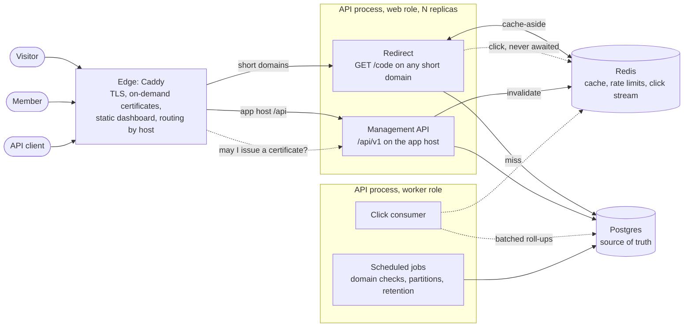
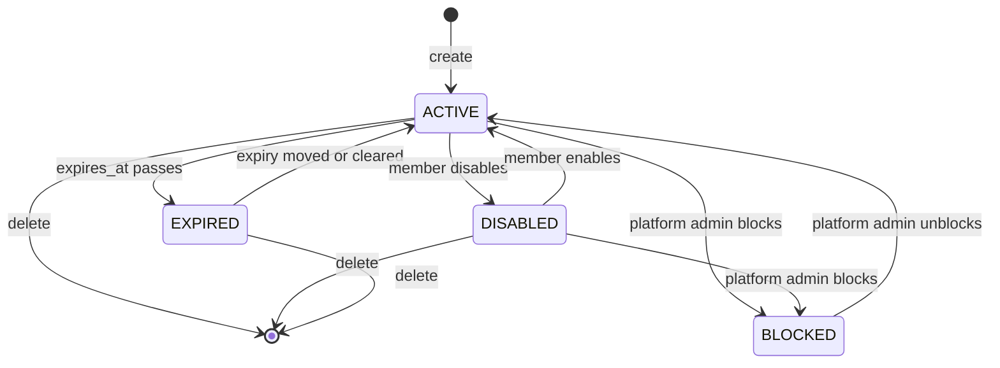
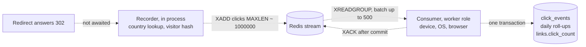
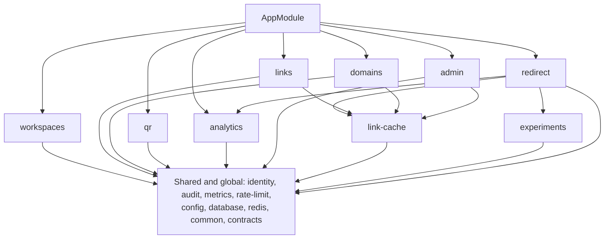

# Link Management Platform - Product Requirements Document

|               |                                                                                                                                                                                                     |
| ------------- | --------------------------------------------------------------------------------------------------------------------------------------------------------------------------------------------------- |
| Status        | Approved for build. Phase 1 is this document plus the foundation; phase 2 is the parallel workstreams in section 17.                                                                                |
| Product       | A production link management platform: short links, custom domains, QR codes, click analytics by country and device, and A/B destination testing.                                                   |
| Source design | "URL Shortener System Design" whiteboard diagram, sections A-L. Its architecture (cache-aside redirect, Postgres as source of truth, analytics off the redirect path) is the core of this platform. |
| Stack         | TypeScript, NestJS, PostgreSQL, Redis, React, Caddy, Docker Compose                                                                                                                                 |

## 1. Problem

A team that shares links wants three things a raw URL cannot give them: a short address on a domain they own, the ability to change, expire, or test where it leads after it has been shared, and an honest picture of who clicked it.

Today that means a subscription to a link management service. This platform is that service: a team signs up, connects its own domain, creates short links and QR codes, splits traffic between destinations, and reads the results on a dashboard, with the same links available through an API.

The workload shapes the design. Links are created rarely and validated carefully. They are followed constantly, by people who never signed up and will not wait. The redirect path must therefore be fast, cheap, and available even when the rest of the platform is degraded, and nothing else (analytics, the dashboard, an experiment) may ever slow it down.

## 2. Goals and non-goals

### Goals

1. **Accounts and workspaces.** A person signs up, verifies their email, and works inside one or more workspaces with teammates. Programs use workspace API keys.
2. **Short links.** Create, edit, disable, expire, and delete links, with generated or custom codes.
3. **Fast, correct redirects.** `GET /{code}` on any connected domain answers `302` through a Redis cache-aside path with Postgres as the source of truth. Unknown is `404`; disabled, expired, or blocked is `410`.
4. **Custom domains.** A workspace connects its own domain, proves ownership through DNS, and gets HTTPS automatically. Each domain is its own namespace of codes.
5. **QR codes.** Every link has a QR code as PNG or SVG, with optional styling, and scans are told apart from ordinary clicks.
6. **Click analytics.** Clicks over time, by country, device, operating system, browser, and referrer, with an estimate of unique visitors, collected without keeping anything that identifies a visitor.
7. **A/B destination testing.** A link can split its traffic between weighted destinations, consistently per visitor, with clicks reported per destination.
8. **A dashboard** for all of the above.
9. **Production readiness.** Security, abuse controls, rate limits, observability, backups, a defined deployment shape, and service level objectives.

### Non-goals for this version

- Billing, plans, and metering. Every workspace gets the same fixed quotas.
- Single sign-on (SAML, OIDC), social sign-in, and two-factor authentication. See decision 3 in section 18.
- Conversion tracking. The platform sees clicks, not what happens on the destination, so it reports traffic per A/B variant but cannot name a winner.
- Per-click targeting (by country, device, or time), password-protected links, link-in-bio pages, and deep links into mobile apps.
- Forwarding query parameters from the short link to the destination, and a UTM builder.
- Logos inside QR codes, and bulk import or export.
- Hour-level analytics beyond the last 7 days, cross-filtering (for example country by device), workspace time zones (days are UTC), and a world map.
- Analytics at ClickHouse or Kafka scale. The stated ceiling is in section 10.
- A public abuse report form, reputation feeds, CAPTCHA, and human review queues.
- Multi-region deployment and a CDN in front of redirects.
- Native mobile apps, browser extensions, and a dark theme.

## 3. Users and roles

| User           | What they do                                                                                                               |
| -------------- | -------------------------------------------------------------------------------------------------------------------------- |
| Visitor        | Follows a short link or scans a QR code. Never signs in, sets no cookie, and is never identified.                          |
| Member         | Creates and manages links, QR codes, and A/B tests in a workspace, and reads its analytics.                                |
| Admin          | Everything a member does, plus domains, API keys, members, invitations, and the audit log.                                 |
| Owner          | Everything an admin does, plus changing roles and renaming or deleting the workspace. A workspace always has at least one. |
| API client     | A program holding a workspace API key. Acts with the member role in that one workspace.                                    |
| Platform admin | Operates the service: blocks abusive links and domains, disables accounts. Granted outside the product.                    |

### Permissions

| Action                                          | Member | Admin | Owner | API key |
| ----------------------------------------------- | ------ | ----- | ----- | ------- |
| Read links, domains, analytics                  | Yes    | Yes   | Yes   | Yes     |
| Create, edit, delete links, variants, QR styles | Yes    | Yes   | Yes   | Yes     |
| Add, verify, remove domains                     | No     | Yes   | Yes   | No      |
| Create and revoke API keys                      | No     | Yes   | Yes   | No      |
| Invite and remove members, read the audit log   | No     | Yes   | Yes   | No      |
| Change roles, rename or delete the workspace    | No     | No    | Yes   | No      |

## 4. Architecture



- **One codebase, two roles.** The API runs as stateless processes. `PROCESS_ROLE` chooses the duties: `web` serves HTTP, `worker` runs the click consumer and scheduled jobs, `all` does both. Redirect capacity and background work therefore scale apart.
- **Routing by host.** The app host (from `APP_URL`) serves the dashboard and `/api`. Every other host is a short domain, the platform's own or a customer's, and only redirects. The management API is not reachable on short domains, and operational endpoints (`/internal`, `/metrics`) are not reachable from outside at all.
- **The diagram's services are modules.** The diagram's gateway, URL service, and redirect service are modules of the API with one-directional dependencies (section 17), so any of them can become its own deployable later.
- **Repository.** A pnpm monorepo: `apps/api` (NestJS), `apps/web` (the dashboard), `packages/contracts` (request and response schemas shared by both), `deploy/` (edge configuration).

## 5. Functional requirements

Requirement ids are stable and referenced by the acceptance criteria (section 19) and the work split (section 17). The Diagram column names the section of the source design each requirement comes from; a dash marks platform scope the diagram does not cover.

### Identity and workspaces

| Id   | Requirement                                                                                           | Diagram |
| ---- | ----------------------------------------------------------------------------------------------------- | ------- |
| ID-1 | Sign up with email, name, and password. The account must verify its email before it can sign in.      | -       |
| ID-2 | Sign in creates a server-side session carried in a cookie; sign out revokes it.                       | A       |
| ID-3 | Password reset by emailed token. Responses never reveal whether an email has an account.              | I       |
| ID-4 | A user can see and revoke their sessions; changing or resetting a password revokes all of them.       | I       |
| ID-5 | Workspaces with owner, admin, and member roles as in section 3. Signing up creates a first workspace. | -       |
| ID-6 | Invite a person by email with a role; the invitation is accepted by the account with that email.      | -       |
| ID-7 | Workspace API keys: created and revoked by admins, shown once, stored hashed.                         | A       |
| ID-8 | Every management request is authorised against the caller's role in the workspace named in the path.  | G, I    |
| ID-9 | Mutating and security-relevant actions are written to an audit log that admins can read.              | I       |

### Links

| Id   | Requirement                                                                                                                                                                                        | Diagram |
| ---- | -------------------------------------------------------------------------------------------------------------------------------------------------------------------------------------------------- | ------- |
| LK-1 | Create a link on a domain the workspace may use, with a destination, and optionally a custom code, title, and expiry.                                                                              | B       |
| LK-2 | The destination must be an absolute `http` or `https` URL with a host. It is stored in normalised form (WHATWG URL serialisation), at most 2,048 characters.                                       | B       |
| LK-3 | Generated codes are 7 Base62 characters from a CSPRNG. A custom code is 3-32 characters of `[A-Za-z0-9_-]` and not a reserved word. Codes are case-sensitive.                                      | C       |
| LK-4 | The `UNIQUE (domain_id, code)` constraint is the only uniqueness guarantee. A collision on a generated code retries with a new code, at most 5 attempts, then `503`. A taken custom code is `409`. | C       |
| LK-5 | The destination passes the risk check in section 13 on create and on every change.                                                                                                                 | I       |
| LK-6 | Edit destination, title, expiry, and status (`ACTIVE` / `DISABLED`). Code and domain never change.                                                                                                 | G       |
| LK-7 | Delete removes the link, its variants, and its roll-ups. The code then answers `404` and may be reused.                                                                                            | G       |
| LK-8 | List links with search over code, title, and destination, filters by status and domain, and cursor pagination.                                                                                     | E       |
| LK-9 | Every write invalidates the redirect cache after the database commit.                                                                                                                              | D       |

### Redirect

| Id    | Requirement                                                                                                                   | Diagram |
| ----- | ----------------------------------------------------------------------------------------------------------------------------- | ------- |
| RD-1  | `GET /{code}` on an active domain answers `302` with `Location` and `Cache-Control: no-store`.                                | F       |
| RD-2  | `302`, never `301`, so every click returns to the platform and edits, expiry, tests, and analytics stay in control.           | F       |
| RD-3  | Unknown code, malformed code, unknown host, or a domain that is not active: `404`.                                            | F, J    |
| RD-4  | Disabled, expired, or blocked link: `410`. A stored status other than active wins over expiry.                                | F, G    |
| RD-5  | Lookup is Redis cache-aside in front of Postgres, keyed by host and code. State is evaluated on every request, cached or not. | D, F    |
| RD-6  | A cache hit is one Redis round trip and no database access.                                                                   | F       |
| RD-7  | Unknown codes are cached negatively for 60 seconds. Concurrent misses for one key in one process share one database read.     | D, J    |
| RD-8  | Redis down: answer from Postgres. Postgres down: keep serving cached links. Both down: `503`.                                 | J       |
| RD-9  | A link with an A/B test redirects to the destination chosen in section 11.                                                    | -       |
| RD-10 | Each `302` hands one click to analytics without awaiting it. Analytics failure never fails or delays a redirect.              | H       |
| RD-11 | Browsers get a small HTML page for `404` and `410`; other clients get the JSON error body.                                    | F       |

### Custom domains

| Id   | Requirement                                                                                                                                        | Diagram |
| ---- | -------------------------------------------------------------------------------------------------------------------------------------------------- | ------- |
| DM-1 | An admin adds a host name; the platform shows the DNS records to create.                                                                           | A       |
| DM-2 | A domain becomes active only after two DNS checks pass: a TXT record proves ownership and the host resolves to the platform.                       | I       |
| DM-3 | Pending domains are re-checked automatically and on request. Active domains are re-checked daily and deactivated after three consecutive failures. | J       |
| DM-4 | Only active domains serve redirects, and each domain is its own namespace of codes.                                                                | E       |
| DM-5 | HTTPS certificates are issued on first use, only for hosts the platform has verified.                                                              | A       |
| DM-6 | The platform's own short domain is available to every workspace.                                                                                   | A       |
| DM-7 | A domain can be removed once no links remain on it.                                                                                                | G       |

### QR codes

| Id   | Requirement                                                                                                            | Diagram |
| ---- | ---------------------------------------------------------------------------------------------------------------------- | ------- |
| QR-1 | Render a link's QR code as SVG or PNG.                                                                                 | -       |
| QR-2 | Optional styling: foreground and background colour, size, margin, error correction level. A link's style can be saved. | -       |
| QR-3 | The code encodes the short URL with a scan marker, so scans are counted separately from clicks.                        | H       |
| QR-4 | Styles that would not scan reliably are refused.                                                                       | -       |

### Analytics

| Id   | Requirement                                                                                                                                        | Diagram |
| ---- | -------------------------------------------------------------------------------------------------------------------------------------------------- | ------- |
| AN-1 | Every non-bot `302` is recorded with time, country, device type, operating system, browser, referrer host, source (link or QR), and A/B variant.   | H       |
| AN-2 | Country comes from a local GeoIP database; device, operating system, and browser from the user agent.                                              | H       |
| AN-3 | No IP address, full referrer, or raw user agent is ever stored. Unique visitors are estimated with a hash whose salt is destroyed within 48 hours. | H       |
| AN-4 | Events travel through a Redis stream to a consumer that writes roll-ups in batches. Delivery is at-least-once; the effect is exactly-once.         | H       |
| AN-5 | Per link: totals, a time series, unique visitors, and a breakdown for each dimension. Per workspace: totals and top links.                         | H       |
| AN-6 | Raw events are kept 90 days; roll-ups for the life of the link.                                                                                    | H       |
| AN-7 | Recognised bots and preview fetchers are redirected but not counted.                                                                               | H       |

### A/B destination testing

| Id   | Requirement                                                                                                                                                       | Diagram |
| ---- | ----------------------------------------------------------------------------------------------------------------------------------------------------------------- | ------- |
| AB-1 | A link can have up to 4 variants, each with a name, a destination, and a weight in percent. The link's own destination is the control and receives the remainder. | -       |
| AB-2 | A visitor is assigned by a keyed hash of the link and the visitor, so the same visitor keeps the same destination without a cookie.                               | -       |
| AB-3 | Assignment can never fail a redirect: whenever a variant cannot be chosen, the control is served.                                                                 | J       |
| AB-4 | Clicks are reported per variant and for the control.                                                                                                              | H       |
| AB-5 | A test ends by promoting a variant (its destination becomes the link's) or by archiving variants. Archived variants keep their history.                           | G       |

### Dashboard

| Id   | Requirement                                                                                                               | Diagram |
| ---- | ------------------------------------------------------------------------------------------------------------------------- | ------- |
| DB-1 | Sign up, verify, sign in, reset password, and manage account and sessions.                                                | -       |
| DB-2 | Switch between workspaces; manage members, invitations, API keys; read the audit log.                                     | -       |
| DB-3 | List, search, create, edit, disable, and delete links.                                                                    | -       |
| DB-4 | Per link: analytics, QR code preview with styling and download, and A/B test management.                                  | -       |
| DB-5 | Add a domain, follow DNS instructions with copyable records, see verification status, re-check, remove.                   | -       |
| DB-6 | Usable from 360 px wide, by keyboard alone, at WCAG 2.1 AA contrast, with loading, empty, and error states in every view. | -       |

### Platform

| Id   | Requirement                                                                                  | Diagram |
| ---- | -------------------------------------------------------------------------------------------- | ------- |
| PL-1 | Rate limits per IP and per credential with `429` and `Retry-After`.                          | A, I    |
| PL-2 | Every request has a request id, echoed in the response and present in logs.                  | A, K    |
| PL-3 | Request bodies are JSON only and capped at 10 kB.                                            | A       |
| PL-4 | A platform admin can block and unblock links and domains and disable accounts.               | I       |
| PL-5 | Liveness, readiness, Prometheus metrics, and structured logs.                                | K       |
| PL-6 | Every failure leaves in one documented error body; an outage is `503`, never a leaked `500`. | J       |

## 6. Identity, workspaces, and access

### Accounts and sessions

- **Passwords** are 12 to 128 characters, hashed with Argon2id, and never logged.
- **Sign-up** always answers `202` and sends mail: a verification link to a new address, or a notice to an address that already has an account. Verification tokens last 24 hours and work once.
- **Sign-in** needs a verified, enabled account. It issues a 256-bit random session token in a `session` cookie that is `HttpOnly`, `Secure` in production, `SameSite=Lax`, and scoped to the app host. Only the token's SHA-256 is stored.
- **Session lifetime.** A session expires after 14 days without use and at most 90 days after sign-in.
- **Failed sign-ins** always return the same `401`. After 5 failures for one account within 15 minutes, that account's sign-in is refused for 15 minutes.
- **Password reset** always answers `202`. Reset tokens last 1 hour and work once. A successful reset revokes every session of the account.
- **Cross-site request forgery.** A state-changing request authenticated by the session cookie must carry an `Origin` header equal to `APP_URL`, or it is refused with `403`. Requests authenticated by API key are exempt, because a browser never attaches one by itself.

### API keys

- Format `usk_` followed by 40 random Base62 characters. The full key is returned once, at creation. The platform stores its SHA-256 and the first 12 characters for display.
- Sent as `Authorization: Bearer <key>`. A key belongs to one workspace and acts with the member role (section 3).
- A key can have an expiry and can be revoked at any time. `last_used_at` is updated at most once a minute.

### Workspaces

- Signing up creates a workspace owned by the new user. A user can create more and belong to many.
- **Invitations** are sent by admins and owners, name an email and a role (`admin` or `member`), and last 7 days. Accepting requires being signed in as the invited email. Roles are changed only by owners.
- The last owner cannot leave or be demoted. Deleting a workspace deletes its links, domains, keys, and analytics; its links then answer `404`.

### Quotas

Fixed for this version, the same for every workspace: 10 custom domains, 25 members, 20 API keys, 4 variants per link. Exceeding one returns `422 QUOTA_EXCEEDED`. Link creation is bounded by rate limits (section 13), not by a count.

### Authorisation rule

Every workspace resource lives under `/api/v1/workspaces/{workspaceId}/`. One rule applies everywhere: a caller who is not in that workspace gets `404` (its existence is not revealed), and a caller whose role is too low gets `403`.

## 7. Links and the redirect path

### Codes

**Decision: random Base62 code plus unique insert** (the diagram's option B), scoped to a domain.

|                                | Random + unique insert (chosen)                                                            | Sequence id + Base62                                                                 |
| ------------------------------ | ------------------------------------------------------------------------------------------ | ------------------------------------------------------------------------------------ |
| Enumerable                     | No. Codes cannot be guessed or walked.                                                     | Yes. Counting upward discovers every link, which leaks a customer's links to anyone. |
| Coordination between instances | None.                                                                                      | Needs a shared id source.                                                            |
| Collision handling             | Needed, and it shares one code path with custom codes, which need the unique check anyway. | Not needed for generated codes, but custom codes still need it.                      |

The keyspace is 62^7, about 3.5 trillion codes per domain. With 10 million links on one domain, an insert collides about 3 times in a million. The collision rate is a metric; if it rises, the code length grows by one character with no migration.

Reserved words (`api`, `health`, `metrics`, `internal`, `admin`, `login`) can never be codes, generated or custom.

### Link states



`ACTIVE`, `DISABLED`, and `BLOCKED` are stored. `EXPIRED` is derived from `expires_at` at read time, so there is one source of truth and correctness never depends on a background job. The effective state is the stored status when it is not `ACTIVE`, otherwise `EXPIRED` when `expires_at <= now`, otherwise `ACTIVE`. A workspace cannot change or delete its way out of `BLOCKED`.

| Effective state                              | `GET /{code}`        |
| -------------------------------------------- | -------------------- |
| `ACTIVE`                                     | `302`                |
| `EXPIRED`                                    | `410 LINK_EXPIRED`   |
| `DISABLED`, `BLOCKED`                        | `410 LINK_DISABLED`  |
| Deleted, never existed, or domain not active | `404 LINK_NOT_FOUND` |

### Redirect cache

The host is the request's `Host` header, lowercased, without a port.

| Key                  | Value                                                                                                   | TTL                                                             |
| -------------------- | ------------------------------------------------------------------------------------------------------- | --------------------------------------------------------------- |
| `domain:{host}`      | `{ "id": "...", "status": "ACTIVE" }` or `{ "notFound": true }`                                         | 5 minutes; 60 s when not found                                  |
| `link:{host}:{code}` | `{ "id", "destinationUrl", "status", "expiresAt", "variants": [{ "id", "destinationUrl", "weight" }] }` | `min(1 hour, time to expiry)`; 60 s for an already expired link |
| `link:{host}:{code}` | `{ "notFound": true }`                                                                                  | 60 s                                                            |
| either key           | `{ "invalidated": true }`, a tombstone                                                                  | 5 s                                                             |

1. **Read.** One `MGET` of both keys. On a hit for both, evaluate the domain status and the link state, choose the destination, and answer. On a miss, read Postgres, populate with `SET ... NX`, then answer. A tombstone counts as a miss that is answered from Postgres and not populated.
2. **A hit is not a free pass.** Domain status, link status, and expiry are evaluated on every request. A link that expires while cached answers `410` at the moment it expires.
3. **Write.** Commit to Postgres first, then overwrite the affected key with a tombstone: the link key when a link or its variants change, the domain key when a domain changes. A plain `DEL` would lose a race, because a reader that read the old row before the commit could write it back afterwards and keep a disabled link alive for the full TTL. With a tombstone in place that reader's `SET ... NX` fails, and after 5 seconds, longer than any read can take under the timeouts in section 13, the next miss repopulates from the committed row.
4. **Lost invalidation.** This is the one case where a stale entry can be served. If writing the tombstone fails because Redis is unreachable at that moment, the write still succeeds (Postgres is the truth), the failure is logged and counted, and the TTL bounds the staleness to 1 hour for a link and 5 minutes for a domain.
5. **Redis errors** on the read path are treated as a miss and answered from Postgres under a 100 ms Redis timeout.

### Redirect response

```http
HTTP/1.1 302 Found
Location: https://example.com/landing
Cache-Control: no-store
```

The redirect sets no cookie. Query parameters on the short URL are not forwarded; the only one the platform reads is the QR scan marker (section 9).

## 8. Custom domains

### Connecting a domain

1. An admin enters a host name, for example `go.brand.com`. It must be a syntactically valid public host name in ASCII form, not an IP address, not already connected by anyone, and not a platform host or one of its subdomains.
2. The platform shows two records to create:

   | Record  | Name                                | Value                           | Proves                            |
   | ------- | ----------------------------------- | ------------------------------- | --------------------------------- |
   | `TXT`   | `_shortener-challenge.go.brand.com` | the domain's verification token | The workspace controls the domain |
   | `CNAME` | `go.brand.com`                      | `CNAME_TARGET`                  | Traffic reaches the platform      |

   For an apex domain, where a `CNAME` is not allowed, an `ALIAS`, `ANAME`, or flattened record to the same target, or `A`/`AAAA` records with the target's addresses, pass the same check.

3. The domain is `PENDING` until both checks pass, then `ACTIVE`.

### Verification

- **Ownership check:** the TXT record at `_shortener-challenge.<host>` equals the token. Without it, a workspace could claim a host whose DNS still points at the platform from a previous owner.
- **Routing check:** the host has a `CNAME` to `CNAME_TARGET`, or its `A`/`AAAA` records are all among the target's.
- **DNS only.** Verification never makes an HTTP request to a customer-supplied host, so it cannot be used to probe internal networks.
- **Schedule.** A pending domain is checked on creation, when an admin asks (at most once a minute), every minute for the first hour, then hourly. After 72 hours without success it becomes `INACTIVE`. An active domain is checked daily and becomes `INACTIVE` after three consecutive failures. An admin can re-verify an inactive domain at any time.
- Every status change tombstones `domain:{host}`, so redirects start or stop within seconds.

| Status     | Redirects  | Meaning                        |
| ---------- | ---------- | ------------------------------ |
| `PENDING`  | No (`404`) | Waiting for DNS                |
| `ACTIVE`   | Yes        | Verified                       |
| `INACTIVE` | No (`404`) | Verification failed or lapsed  |
| `BLOCKED`  | No (`404`) | Taken down by a platform admin |

### HTTPS

The edge is Caddy with on-demand TLS. On the first HTTPS request for a host it has no certificate for, Caddy asks the API `GET /internal/tls/authorize?domain=<host>` and requests a certificate from Let's Encrypt only on `200`. The endpoint answers `200` for platform hosts and `ACTIVE` domains and `404` otherwise, from the same `domain:{host}` cache entry the redirect uses, and is reachable only on the internal network. Certificates renew automatically. Plain HTTP on a short domain redirects to HTTPS.

### The platform domain

`DEFAULT_SHORT_DOMAIN` is a domain row with no workspace, created at start-up if missing, always `ACTIVE`, and usable by every workspace. A custom code on it is first come, first served across all workspaces.

## 9. QR codes

- `GET .../links/{linkId}/qr` returns the code as `image/svg+xml` (default) or `image/png`.
- **Content.** The code encodes the short URL with a scan marker: `https://go.brand.com/launch?r=qr`. The redirect records a click whose `r` parameter is exactly `qr` as source `qr` and everything else as source `link`. The marker is not forwarded to the destination.
- **Styling.**

  | Option                     | Values                                    | Default            |
  | -------------------------- | ----------------------------------------- | ------------------ |
  | `format`                   | `svg`, `png`                              | `svg`              |
  | `size`                     | 128 to 2048 pixels (PNG), ignored for SVG | 512                |
  | `margin`                   | 0 to 16 modules                           | 4                  |
  | `foreground`, `background` | 6-digit hex colours                       | `000000`, `ffffff` |
  | `errorCorrection`          | `L`, `M`, `Q`, `H`                        | `M`                |

- **Saved style.** `PUT .../links/{linkId}/qr-style` stores a link's style. Rendering uses the saved style, and query parameters override it for one request.
- **Scannability.** A foreground and background with a contrast ratio below 3:1 is refused with `400`, because such codes do not scan reliably.
- **Caching.** Responses carry an `ETag` and `Cache-Control: private, max-age=300`.
- A QR code keeps working when the link's destination changes, because it encodes the short URL, never the destination.

## 10. Click analytics

### Pipeline



- **Recorder.** Runs after the redirect decision, is never awaited, and never throws. It turns the IP address into a country and a visitor hash immediately, in memory, and puts the event on the stream without the IP. On any failure the event is dropped and counted.
- **Stream.** Capped at about one million entries. If the consumer falls that far behind, the oldest events are discarded rather than letting Redis grow without bound.
- **Consumer.** One consumer group on its own Redis connection, in processes with the worker role. In a single transaction per batch it inserts the events with `ON CONFLICT DO NOTHING`, and for the rows actually inserted it increments the roll-ups and `links.click_count`. It acknowledges only after the commit. Entries left pending by a crashed consumer are reclaimed after 60 seconds. It creates its group when missing, at start-up and whenever Redis reports it gone. Events for links that no longer exist are acknowledged and discarded.
- **Consistency.** At-least-once delivery, exactly-once effect through `event_id`. A click appears on the dashboard within 30 seconds at the 95th percentile.

### What is recorded

| Field                     | Source                         | Stored as                                                |
| ------------------------- | ------------------------------ | -------------------------------------------------------- |
| Time                      | Clock at the redirect          | Timestamp                                                |
| Country                   | GeoIP lookup of the IP address | ISO 3166-1 alpha-2, `ZZ` when unknown                    |
| Device type               | User agent                     | `desktop`, `mobile`, `tablet`, `bot`, `other`            |
| Operating system, browser | User agent                     | Family name without version, for example `iOS`, `Safari` |
| Referrer                  | `Referer` header               | Host only, lowercased; none means a direct visit         |
| Source                    | `r=qr` marker                  | `link` or `qr`                                           |
| Variant                   | A/B assignment                 | Variant id, or none for the control                      |

### Privacy

- The **IP address** exists only in memory, for the country lookup and the visitor hash. It is never stored, queued, or logged. The edge's access logs for short domains omit it.
- The **visitor hash** is `HMAC-SHA256(salt of the day, IP + user agent)`, truncated to 16 bytes. The salt is random, generated once per UTC day, and deleted after 48 hours together with that day's hashes. After that, nothing stored can be traced to a visitor or even linked across days.
- **Unique visitors** are therefore exact per day and an estimate over a range: a range sums its days, so a visitor who returns on two days counts twice. The dashboard labels the figure accordingly.
- Raw events hold no hash at all. No cookie is set on any short domain.

### Bots

A user agent recognised as a crawler, monitor, or link-preview fetcher is redirected like anyone else. Its event is stored with device type `bot` and excluded from every roll-up, from unique visitors, and from `click_count`.

### Storage and retention

| Data                                         | Kept             | Removed by                       |
| -------------------------------------------- | ---------------- | -------------------------------- |
| `click_events`, raw, partitioned by month    | 90 days          | Dropping whole partitions        |
| `link_daily_totals`, `link_daily_breakdowns` | Life of the link | Cascade when the link is deleted |
| `link_daily_visitors`, `visitor_salts`       | 48 hours         | Daily job                        |

A daily job creates the partitions for the next two months and drops those past retention. A default partition catches any event outside the prepared range, and a non-empty default partition raises an alert.

### Queries

- **Per link:** total clicks and unique visitors for a date range, a time series, and for each dimension (country, device, operating system, browser, referrer, source, variant) the top values with their clicks, with the remainder summed as "other".
- **Per workspace:** totals for the range, a daily series, and the top links.
- **Granularity:** daily, from the roll-ups, for any range. Hourly for ranges up to 7 days within the last 90 days, from raw events.
- Days are UTC.

### Capacity

Roll-ups keep dashboard queries independent of click volume. The design target is 50 million clicks a month on a single Postgres instance. Beyond that, raw events move to a column store (decision 7 in section 18); the recorder, stream, and query API stay as they are.

## 11. A/B destination testing

### Model

- A link's `destination_url` is the **control**. A test adds up to 4 **variants**, each with a name, a destination, and a weight from 1 to 99 percent.
- The weights of the active variants sum to at most 99. The control receives the remainder, so it always gets traffic and is always there to fall back to.
- A variant's destination passes the same validation and risk check as any destination.
- Variants are managed without changing the link's code, so a test can start on a link that is already in circulation, including through printed QR codes.

### Assignment

1. Compute `bucket = HMAC-SHA256(key, linkId + IP + user agent) mod 10000`, a number spread evenly from 0 to 9,999. The key is derived from `APP_SECRET`.
2. Lay the active variants on that range in order of creation, each taking `weight x 100` buckets. The control takes whatever is left at the top.
3. Serve the destination that owns the visitor's bucket.

This is **sticky without state**: the same visitor on the same network and browser always lands on the same destination, with no cookie and nothing stored. It is deterministic across instances and restarts. Two consequences are accepted and stated in the dashboard: a visitor who changes network or browser may be reassigned, and changing weights moves the boundaries, so some visitors switch.

### Safe fallback

Assignment is a pure function that cannot fail a redirect. If the cached variants are empty, malformed, or sum past 99, the control is served. The variants travel in the link's cache entry, so a test costs the redirect no extra lookup.

### Results and ending a test

- Clicks are reported per variant and for the control, as totals and as a daily series, through the `variant` breakdown (section 10).
- The platform measures clicks, not conversions. It shows how traffic was split; it cannot tell which destination performed better.
- **Promote** a variant: its destination becomes the link's destination and every variant is archived. **Archive** a variant: its traffic returns to the control. Archived variants receive no traffic and keep their name and history.

## 12. Dashboard

A single-page application served as static files by the edge on the app host, calling `/api` on the same origin.

**Stack:** React 19, TypeScript, Vite, React Router, TanStack Query for server state, Tailwind CSS, Recharts for charts. Forms validate with the same Zod schemas the API uses, from `packages/contracts`.

| Area        | Views                                                                                                                                                                                                                                                         |
| ----------- | ------------------------------------------------------------------------------------------------------------------------------------------------------------------------------------------------------------------------------------------------------------- |
| Account     | Sign up, verify email, sign in, reset password, profile, password, active sessions                                                                                                                                                                            |
| Workspace   | Switcher, create workspace, general settings, members and invitations, API keys, audit log                                                                                                                                                                    |
| Links       | List with search, filters, and pagination; create and edit; disable, enable, delete                                                                                                                                                                           |
| Link detail | Analytics: range picker, time series, unique visitors, countries, devices, operating systems, browsers, referrers, link against QR. QR code: live preview, styling, download as PNG or SVG. A/B test: variants, weights, per-variant clicks, promote, archive |
| Domains     | Add, DNS instructions with copyable records, status, verify now, remove                                                                                                                                                                                       |

**Quality bar.** Every view has loading, empty, and error states. Layouts work from 360 px wide. Everything is reachable by keyboard, labelled for screen readers, and meets WCAG 2.1 AA contrast. Destructive actions ask for confirmation. Supported browsers are the last two versions of Chrome, Edge, Firefox, and Safari.

## 13. Production concerns

### Security

| Area                 | Control                                                                                                                                                                  |
| -------------------- | ------------------------------------------------------------------------------------------------------------------------------------------------------------------------ |
| Passwords and tokens | Argon2id for passwords. Session, API key, verification, reset, and invitation tokens are random, shown or mailed once, and stored only as SHA-256 hashes.                |
| Sessions             | `HttpOnly`, `Secure`, `SameSite=Lax`, host-only cookie; idle and absolute expiry; revocation; `Origin` check on state-changing requests.                                 |
| Tenancy              | One authorisation rule (section 6), enforced on every workspace route. Queries are always scoped by workspace.                                                           |
| Input                | Every request body, query, and path parameter is validated against a schema. Bodies are JSON only, capped at 10 kB.                                                      |
| Transport            | HTTPS everywhere through the edge; HSTS on the app host; security headers and a content security policy on the dashboard.                                                |
| Host separation      | The management API is served only on the app host. `/internal` and `/metrics` are not exposed.                                                                           |
| Secrets              | From the environment only, validated at start-up, never logged.                                                                                                          |
| Logging              | Destination URLs are never logged in full, because they can carry tokens; logs carry the link id and destination host. IP addresses are not logged on the redirect path. |
| Dependencies         | A frozen lockfile and a minimum release age for new versions.                                                                                                            |
| Audit                | The audit log records who did what, to what, and when (section 6).                                                                                                       |

### Abuse

- **Destination risk check**, on create and on every destination change, for links and variants. Refused with `422 DESTINATION_BLOCKED` when the host is on the operator's blocklist (`BLOCKED_HOSTS`, including subdomains), is the app host or any connected short domain (which would loop), or is `localhost` or a private, loopback, or link-local IP literal.
- **Re-check.** A daily job re-runs the blocklist over existing links and blocks the matches, so a destination that turns bad later does not keep working.
- **Takedown.** A platform admin can block a link or a domain and disable an account. A blocked link answers `410` on the next request. Blocking is audited and cannot be undone by the workspace.
- **Sign-up friction.** Email verification before any link can be created, and rate limits on every unauthenticated endpoint.
- **Not enumerable.** Codes and ids cannot be guessed, and responses never reveal whether an email or a workspace exists.

### Rate limits

Fixed 60 second windows, counted in Redis with an atomic increment-and-expire.

| Policy       | Applies to                                                                  | Keyed by                            | Default per minute | Variable                           |
| ------------ | --------------------------------------------------------------------------- | ----------------------------------- | ------------------ | ---------------------------------- |
| `redirect`   | `GET /{code}`                                                               | Client IP                           | 600                | `RATE_LIMIT_REDIRECT_PER_MINUTE`   |
| `api`        | Every `/api/v1/*` request                                                   | Client IP                           | 300                | `RATE_LIMIT_API_PER_MINUTE`        |
| `credential` | Every `/api/v1/*` request that presents a session or API key                | SHA-256 of the presented credential | 600                | `RATE_LIMIT_CREDENTIAL_PER_MINUTE` |
| `auth`       | Sign-up, sign-in, password reset, email verification, invitation acceptance | Client IP                           | 10                 | `RATE_LIMIT_AUTH_PER_MINUTE`       |

- A request must pass every policy that applies. A refusal is `429 RATE_LIMITED` with `Retry-After`.
- The limiter is a global guard and authentication is a guard on controllers, so limiting always runs first and guessing credentials is itself limited.
- A request the body parser rejects (malformed JSON, over 10 kB) is answered before the limiter and is not counted.
- The client IP honours `TRUST_PROXY_HOPS`. An IPv6 client is keyed by its /64 prefix, because one subscriber controls a whole /64.
- If Redis is unavailable the limiter fails open for redirects and fails closed with `503` for the management API.
- The policies are one injectable provider built from configuration, so the limiter's own tests can use small limits and a short window. The shared test environment sets every limit high enough that no other suite can trip one.
- Health and metrics endpoints are exempt.

### Reliability

| Failure                 | Behaviour                                                                                                        |
| ----------------------- | ---------------------------------------------------------------------------------------------------------------- |
| Redis unavailable       | Redirects are answered from Postgres. Clicks are dropped and counted. Management API rate limiting fails closed. |
| Postgres unavailable    | Cached links keep redirecting. Uncached codes and every write answer `503`.                                      |
| Both unavailable        | `503`. No unbounded retries.                                                                                     |
| Worker down             | Redirects are unaffected. Clicks queue in the stream up to its cap and are processed on recovery.                |
| GeoIP database missing  | Clicks are recorded with country `ZZ`. A warning is logged at start-up.                                          |
| Mail provider down      | Sign-up and reset still answer `202`; the send is retried with backoff for 15 minutes, then logged as failed.    |
| Lost cache invalidation | Bounded by the TTLs in section 7, logged, and counted.                                                           |

Timeouts: Redis command 100 ms, Postgres statement 2 s, Postgres connect 2 s, DNS lookup 3 s.

### Observability

- `GET /health` is liveness and touches no dependency. `GET /health/ready` reports Postgres and Redis: `ok`, `degraded` with one down (still `200`, because the process keeps serving what it can), `unavailable` with `503` only when both are down.
- `GET /metrics` in Prometheus format, on the internal network only:

  | Metric                                   | Type      | Labels                                                                |
  | ---------------------------------------- | --------- | --------------------------------------------------------------------- |
  | `http_request_duration_seconds`          | Histogram | `route`, `method`, `status`                                           |
  | `redirects_total`                        | Counter   | `outcome` = `found` / `not_found` / `gone` / `unavailable`            |
  | `link_cache_lookups_total`               | Counter   | `result` = `hit` / `miss` / `negative_hit` / `error`                  |
  | `link_cache_invalidation_failures_total` | Counter   |                                                                       |
  | `links_created_total`                    | Counter   | `kind` = `generated` / `custom`                                       |
  | `short_code_collisions_total`            | Counter   |                                                                       |
  | `rate_limit_rejections_total`            | Counter   | `policy`                                                              |
  | `click_events_total`                     | Counter   | `result` = `recorded` / `dropped` / `persisted` / `duplicate` / `bot` |
  | `click_stream_lag`                       | Gauge     |                                                                       |
  | `domain_verifications_total`             | Counter   | `result` = `verified` / `pending` / `failed`                          |
  | `sign_ins_total`                         | Counter   | `result` = `success` / `failure` / `locked`                           |
  | `qr_codes_rendered_total`                | Counter   | `format`                                                              |

  Route labels use the route pattern, never the actual path, to keep cardinality bounded.

- **Logs** are JSON in production, one record per line, each with the request id.
- **Alerts:** an objective burning its error budget, redirect latency over target, cache hit ratio under 80%, click stream lag over 5 minutes, a non-empty default partition, certificate issuance failures, and a failed backup.

### Backups and recovery

| Data           | Protection                                                                                                                      | Objective                                                                                      |
| -------------- | ------------------------------------------------------------------------------------------------------------------------------- | ---------------------------------------------------------------------------------------------- |
| Postgres       | Continuous WAL archiving with point-in-time recovery, plus a daily logical dump kept 30 days, both stored off the database host | Lose at most 5 minutes; restore within 1 hour                                                  |
| Redis          | Append-only file, synced every second                                                                                           | Disposable by design: losing it costs cached entries and at most seconds of unprocessed clicks |
| Certificates   | Persistent volume at the edge                                                                                                   | Re-issued automatically if lost                                                                |
| GeoIP database | Refreshed monthly                                                                                                               | Re-downloadable                                                                                |

A restore is rehearsed before launch and every quarter after.

### Deployment

- **Shape.** Containers: `edge` (Caddy, the only public entry point), `api` with the web role (two or more), `api` with the worker role (one or more), Postgres, Redis, and a one-shot `migrate` job that runs before a new version starts.
- **Stateless API.** Any replica can serve any request, so rolling out is replacing replicas one at a time.
- **Migrations** are explicit, run once per release, and backward compatible with the previous version (add first, remove in a later release), so a release can be rolled back.
- **Edge.** One edge node keeps certificates on a local volume. More than one needs a shared certificate store.
- **Target.** Docker Compose on a Linux host is the supported production shape for this version (decision 1 in section 18). Nothing in the application depends on it.

### Service level objectives

Measured monthly.

| Objective                                                                           | Target                           |
| ----------------------------------------------------------------------------------- | -------------------------------- |
| Redirect availability at the edge (`302`, `404`, and `410` are all correct answers) | 99.95%                           |
| Redirect latency at the API, cache hit                                              | p95 under 20 ms, p99 under 50 ms |
| Redirect latency at the API, cache miss                                             | p95 under 100 ms                 |
| Management API availability                                                         | 99.9%                            |
| Management API latency                                                              | p95 under 300 ms                 |
| Click to visible on the dashboard                                                   | p95 under 30 s                   |
| Cache hit ratio in steady state                                                     | Above 90%                        |
| Domain active after correct DNS is visible                                          | Within 2 minutes                 |

Latency and hit-ratio objectives are verified by a load test before launch (section 17, hardening); they are not gated in CI.

## 14. API contract

The base path is `/api/v1` on the app host. Bodies are JSON. Timestamps are ISO 8601 in UTC. Ids are UUIDs. Unknown properties in a request body are rejected.

**Authentication** is the session cookie, or `Authorization: Bearer <api key>`.

**Pagination.** List endpoints take `limit` (1 to 100, default 25) and `cursor`, and return `{ "items": [...], "nextCursor": "..." | null }`.

### Error body

```json
{
  "statusCode": 409,
  "error": "Conflict",
  "code": "CODE_TAKEN",
  "message": "The code \"launch\" is already in use on this domain"
}
```

`code` is the machine-readable contract; `message` is for people and may change.

| Status | `code`                                                                          | When                                                                                           |
| ------ | ------------------------------------------------------------------------------- | ---------------------------------------------------------------------------------------------- |
| `400`  | `VALIDATION_FAILED`                                                             | Malformed JSON, or a body, query, or path parameter that fails its schema                      |
| `401`  | `UNAUTHENTICATED`                                                               | Missing, invalid, or expired credentials; wrong email or password                              |
| `403`  | `FORBIDDEN`                                                                     | Role too low, or a cross-site request                                                          |
| `404`  | `NOT_FOUND`, `LINK_NOT_FOUND`                                                   | Unknown resource, a workspace the caller is not in, or an unknown short code                   |
| `409`  | `CODE_TAKEN`, `CONFLICT`                                                        | Custom code in use on the domain; domain already connected; domain still has links; last owner |
| `410`  | `LINK_DISABLED`, `LINK_EXPIRED`                                                 | Redirect to a disabled, blocked, or expired link                                               |
| `413`  | `PAYLOAD_TOO_LARGE`                                                             | Body over 10 kB                                                                                |
| `422`  | `CODE_RESERVED`, `DESTINATION_BLOCKED`, `DOMAIN_NOT_VERIFIED`, `QUOTA_EXCEEDED` | A well-formed request refused by a business rule                                               |
| `429`  | `RATE_LIMITED`                                                                  | Rate limit exceeded; `Retry-After` is set                                                      |
| `500`  | `INTERNAL_ERROR`                                                                | Unexpected failure. No internal detail; the cause is logged with the request id.               |
| `503`  | `SERVICE_UNAVAILABLE`, `CODE_GENERATION_EXHAUSTED`                              | A required dependency is down, or no unique code could be allocated                            |

`400` means the request is malformed; `422` means it is well-formed but refused. Any other client error raised by the framework carries `REQUEST_REJECTED`.

### Resources

A **link**. `status` is the effective state: `ACTIVE`, `DISABLED`, `BLOCKED`, or `EXPIRED`.

```json
{
  "id": "0193d2a0-6c1e-7b3a-9f4e-2d1c0b9a8f7e",
  "domain": {
    "id": "0193d2a0-5a00-7c11-8e22-1f0e9d8c7b6a",
    "hostname": "go.brand.com"
  },
  "code": "launch",
  "shortUrl": "https://go.brand.com/launch",
  "destinationUrl": "https://example.com/landing",
  "title": "Spring launch",
  "status": "ACTIVE",
  "expiresAt": null,
  "clickCount": 1284,
  "variantCount": 1,
  "createdAt": "2026-11-27T08:00:00.000Z",
  "updatedAt": "2026-11-27T08:00:00.000Z"
}
```

A **domain**.

```json
{
  "id": "0193d2a0-5a00-7c11-8e22-1f0e9d8c7b6a",
  "hostname": "go.brand.com",
  "status": "PENDING",
  "isPlatformDomain": false,
  "dnsRecords": [
    {
      "type": "TXT",
      "name": "_shortener-challenge.go.brand.com",
      "value": "sv_4f9c2e7a",
      "verified": true
    },
    {
      "type": "CNAME",
      "name": "go.brand.com",
      "value": "cname.sho.rt",
      "verified": false
    }
  ],
  "verifiedAt": null,
  "lastCheckedAt": "2026-11-27T08:01:00.000Z",
  "createdAt": "2026-11-27T08:00:00.000Z"
}
```

A **variant**.

```json
{
  "id": "0193d2a1-0000-7d44-a1b2-c3d4e5f60718",
  "name": "Shorter headline",
  "destinationUrl": "https://example.com/landing-b",
  "weight": 30,
  "archivedAt": null,
  "createdAt": "2026-11-27T09:00:00.000Z"
}
```

**Link analytics.** `uniqueVisitors` in `series` is present for daily intervals only.

```json
{
  "range": { "from": "2026-11-01", "to": "2026-11-27", "interval": "day" },
  "totals": { "clicks": 1284, "uniqueVisitors": 911 },
  "series": [{ "bucket": "2026-11-26", "clicks": 310, "uniqueVisitors": 240 }],
  "breakdowns": {
    "country": [
      { "value": "DE", "clicks": 512 },
      { "value": "other", "clicks": 97 }
    ],
    "device": [{ "value": "mobile", "clicks": 801 }],
    "os": [{ "value": "iOS", "clicks": 640 }],
    "browser": [{ "value": "Safari", "clicks": 598 }],
    "referrer": [{ "value": "(direct)", "clicks": 640 }],
    "source": [
      { "value": "link", "clicks": 1100 },
      { "value": "qr", "clicks": 184 }
    ],
    "variant": [
      { "value": "control", "clicks": 900 },
      { "value": "0193d2a1-0000-7d44-a1b2-c3d4e5f60718", "clicks": 384 }
    ]
  }
}
```

### Endpoints

`{ws}` stands for `workspaces/{workspaceId}`. Role is the minimum role; Key says whether an API key may call it.

| Method and path                                                                                      | Role              | Key | Success                                               |
| ---------------------------------------------------------------------------------------------------- | ----------------- | --- | ----------------------------------------------------- |
| **Account**                                                                                          |                   |     |                                                       |
| `POST /auth/sign-up` `{ email, name, password }`                                                     | Public            |     | `202`                                                 |
| `POST /auth/verify-email` `{ token }`                                                                | Public            |     | `204`                                                 |
| `POST /auth/sign-in` `{ email, password }`                                                           | Public            |     | `200` user, sets the session cookie                   |
| `POST /auth/sign-out`                                                                                | Session           | No  | `204`                                                 |
| `POST /auth/password-reset` `{ email }`                                                              | Public            |     | `202`                                                 |
| `POST /auth/password-reset/confirm` `{ token, password }`                                            | Public            |     | `204`                                                 |
| `GET /me`                                                                                            | Any               | Yes | `200` user or key identity, with workspaces and roles |
| `PATCH /me` `{ name?, currentPassword?, newPassword? }`                                              | Session           | No  | `200`                                                 |
| `GET /me/sessions`, `DELETE /me/sessions/{sessionId}`                                                | Session           | No  | `200`, `204`                                          |
| **Workspaces**                                                                                       |                   |     |                                                       |
| `POST /workspaces` `{ name }`                                                                        | Session           | No  | `201`                                                 |
| `GET /{ws}`                                                                                          | Member            | Yes | `200`                                                 |
| `PATCH /{ws}` `{ name }`, `DELETE /{ws}`                                                             | Owner             | No  | `200`, `204`                                          |
| `GET /{ws}/members`                                                                                  | Member            | No  | `200`                                                 |
| `PATCH /{ws}/members/{userId}` `{ role }`                                                            | Owner             | No  | `200`                                                 |
| `DELETE /{ws}/members/{userId}`                                                                      | Admin, or oneself | No  | `204`                                                 |
| `GET /{ws}/invitations`, `POST /{ws}/invitations` `{ email, role }`, `DELETE /{ws}/invitations/{id}` | Admin             | No  | `200`, `201`, `204`                                   |
| `POST /invitations/accept` `{ token }`                                                               | Session           | No  | `200` workspace                                       |
| `GET /{ws}/api-keys`, `POST /{ws}/api-keys` `{ name, expiresAt? }`, `DELETE /{ws}/api-keys/{id}`     | Admin             | No  | `200`, `201` with the key once, `204`                 |
| `GET /{ws}/audit-log`                                                                                | Admin             | No  | `200` list                                            |
| **Domains**                                                                                          |                   |     |                                                       |
| `GET /{ws}/domains`                                                                                  | Member            | Yes | `200` list, including platform domains                |
| `POST /{ws}/domains` `{ hostname }`                                                                  | Admin             | No  | `201` domain                                          |
| `GET /{ws}/domains/{domainId}`                                                                       | Member            | Yes | `200` domain                                          |
| `POST /{ws}/domains/{domainId}/verify`                                                               | Admin             | No  | `200` domain after a fresh check                      |
| `DELETE /{ws}/domains/{domainId}`                                                                    | Admin             | No  | `204`, or `409` while links remain                    |
| **Links**                                                                                            |                   |     |                                                       |
| `GET /{ws}/links` `?search&status&domainId&limit&cursor`                                             | Member            | Yes | `200` list                                            |
| `POST /{ws}/links` `{ destinationUrl, domainId?, code?, title?, expiresAt? }`                        | Member            | Yes | `201` link                                            |
| `GET /{ws}/links/{linkId}`                                                                           | Member            | Yes | `200` link                                            |
| `PATCH /{ws}/links/{linkId}` `{ destinationUrl?, title?, expiresAt?, status? }`                      | Member            | Yes | `200` link                                            |
| `DELETE /{ws}/links/{linkId}`                                                                        | Member            | Yes | `204`                                                 |
| `GET /{ws}/links/{linkId}/variants`                                                                  | Member            | Yes | `200` list, including archived                        |
| `POST /{ws}/links/{linkId}/variants` `{ name, destinationUrl, weight }`                              | Member            | Yes | `201` variant                                         |
| `PATCH /{ws}/links/{linkId}/variants/{variantId}` `{ name?, destinationUrl?, weight? }`              | Member            | Yes | `200` variant                                         |
| `POST /{ws}/links/{linkId}/variants/{variantId}/archive`                                             | Member            | Yes | `200` variant                                         |
| `POST /{ws}/links/{linkId}/variants/{variantId}/promote`                                             | Member            | Yes | `200` link                                            |
| **QR codes**                                                                                         |                   |     |                                                       |
| `GET /{ws}/links/{linkId}/qr` `?format&size&margin&foreground&background&errorCorrection`            | Member            | Yes | `200` image                                           |
| `PUT /{ws}/links/{linkId}/qr-style` `{ foreground?, background?, margin?, errorCorrection? }`        | Member            | Yes | `200` style                                           |
| **Analytics**                                                                                        |                   |     |                                                       |
| `GET /{ws}/links/{linkId}/analytics` `?from&to&interval&top`                                         | Member            | Yes | `200` link analytics                                  |
| `GET /{ws}/analytics` `?from&to`                                                                     | Member            | Yes | `200` totals, daily series, top links                 |
| **Platform admin**                                                                                   |                   |     |                                                       |
| `POST /admin/links/{linkId}/block`, `.../unblock`                                                    | Platform admin    | No  | `200`                                                 |
| `POST /admin/domains/{domainId}/block`, `.../unblock`                                                | Platform admin    | No  | `200`                                                 |
| `POST /admin/users/{userId}/disable`, `.../enable`                                                   | Platform admin    | No  | `200`                                                 |

`domainId` defaults to the platform domain. When `code` is omitted one is generated. In a `PATCH`, at least one field is required, `expiresAt: null` removes the expiry, and `status` accepts `ACTIVE` or `DISABLED`.

### Outside `/api/v1`

| Endpoint                              | Where                 | Purpose                                         |
| ------------------------------------- | --------------------- | ----------------------------------------------- |
| `GET /{code}`                         | Every short domain    | The redirect: `302`, `404`, `410`, `429`, `503` |
| `GET /health`, `GET /health/ready`    | Every host            | Liveness and readiness                          |
| `GET /metrics`                        | Internal network only | Prometheus metrics                              |
| `GET /internal/tls/authorize?domain=` | Internal network only | Whether the edge may obtain a certificate       |

## 15. Data model

PostgreSQL 18. Primary keys are UUIDv7 generated by the database (`uuidv7()`): time-ordered, so they index like a sequence, and safe to expose because they cannot be counted through. Every table has `created_at`; mutable ones have `updated_at`. All timestamps are `TIMESTAMPTZ`.

### Identity

| Table          | Columns                                                                                                                                | Constraints and notes                                                  |
| -------------- | -------------------------------------------------------------------------------------------------------------------------------------- | ---------------------------------------------------------------------- |
| `users`        | `id`, `email VARCHAR(320)`, `name VARCHAR(100)`, `password_hash TEXT`, `email_verified_at`, `is_platform_admin BOOLEAN`, `disabled_at` | `UNIQUE (email)`; email is stored lowercase (`CHECK`)                  |
| `sessions`     | `id`, `user_id`, `token_hash BYTEA`, `user_agent VARCHAR(255)`, `last_seen_at`, `expires_at`                                           | `UNIQUE (token_hash)`; cascades with the user                          |
| `email_tokens` | `id`, `user_id`, `purpose`, `token_hash BYTEA`, `expires_at`, `used_at`                                                                | `purpose` is `verify_email` or `reset_password`; `UNIQUE (token_hash)` |

### Workspaces

| Table                   | Columns                                                                                                                                    | Constraints and notes                                                          |
| ----------------------- | ------------------------------------------------------------------------------------------------------------------------------------------ | ------------------------------------------------------------------------------ |
| `workspaces`            | `id`, `name VARCHAR(100)`, `slug VARCHAR(48)`                                                                                              | `UNIQUE (slug)`                                                                |
| `workspace_members`     | `workspace_id`, `user_id`, `role`                                                                                                          | Primary key `(workspace_id, user_id)`; `role` is `owner`, `admin`, or `member` |
| `workspace_invitations` | `id`, `workspace_id`, `email`, `role`, `token_hash BYTEA`, `invited_by_user_id`, `expires_at`, `accepted_at`                               | `UNIQUE (workspace_id, email)`, `UNIQUE (token_hash)`                          |
| `api_keys`              | `id`, `workspace_id`, `name`, `key_prefix VARCHAR(16)`, `key_hash BYTEA`, `created_by_user_id`, `last_used_at`, `expires_at`, `revoked_at` | `UNIQUE (key_hash)`                                                            |
| `audit_log`             | `id`, `workspace_id`, `actor_type`, `actor_id`, `action VARCHAR(64)`, `target_type`, `target_id`, `metadata JSONB`                         | `actor_type` is `user`, `api_key`, or `system`; append-only                    |

### Domains and links

| Table           | Columns                                                                                                                                                                                               | Constraints and notes                                                                                                                                                                     |
| --------------- | ----------------------------------------------------------------------------------------------------------------------------------------------------------------------------------------------------- | ----------------------------------------------------------------------------------------------------------------------------------------------------------------------------------------- |
| `domains`       | `id`, `workspace_id` (null for a platform domain), `hostname VARCHAR(253) COLLATE "C"`, `status`, `verification_token`, `verified_at`, `last_checked_at`                                              | `UNIQUE (hostname)`; hostname stored lowercase; `status` is `PENDING`, `ACTIVE`, `INACTIVE`, or `BLOCKED`                                                                                 |
| `links`         | `id`, `workspace_id`, `domain_id`, `code VARCHAR(32) COLLATE "C"`, `destination_url TEXT`, `title VARCHAR(200)`, `status`, `expires_at`, `qr_style JSONB`, `click_count BIGINT`, `created_by_user_id` | `UNIQUE (domain_id, code)`, the final guard on codes; destination at most 2,048 characters; `status` is `ACTIVE`, `DISABLED`, or `BLOCKED`; a domain cannot be deleted while it has links |
| `link_variants` | `id`, `link_id`, `name VARCHAR(50)`, `destination_url TEXT`, `weight SMALLINT`, `archived_at`                                                                                                         | `weight` between 1 and 99; cascades with the link                                                                                                                                         |

`links.updated_at` changes only when someone edits the link. The click roll-up increments `click_count` without touching it.

### Analytics

| Table                   | Columns                                                                                                                                                                   | Constraints and notes                                                                                                                                           |
| ----------------------- | ------------------------------------------------------------------------------------------------------------------------------------------------------------------------- | --------------------------------------------------------------------------------------------------------------------------------------------------------------- |
| `click_events`          | `event_id UUID`, `clicked_at`, `link_id`, `variant_id`, `source`, `country CHAR(2)`, `device_type`, `os VARCHAR(32)`, `browser VARCHAR(32)`, `referrer_host VARCHAR(255)` | Partitioned by month on `clicked_at`; primary key `(event_id, clicked_at)`; index `(link_id, clicked_at)`; no foreign key, because rows leave by partition drop |
| `link_daily_totals`     | `link_id`, `day DATE`, `clicks`, `unique_visitors`                                                                                                                        | Primary key `(link_id, day)`; cascades with the link                                                                                                            |
| `link_daily_breakdowns` | `link_id`, `day`, `dimension`, `value VARCHAR(255)`, `clicks`                                                                                                             | Primary key `(link_id, day, dimension, value)`; `dimension` is `country`, `device`, `os`, `browser`, `referrer`, `source`, or `variant`                         |
| `link_daily_visitors`   | `link_id`, `day`, `visitor_hash BYTEA`                                                                                                                                    | Primary key on all three; rows deleted after 48 hours                                                                                                           |
| `visitor_salts`         | `day DATE`, `salt BYTEA`                                                                                                                                                  | One row per UTC day; deleted after 48 hours                                                                                                                     |

Two deliberate differences from the diagram's single `URL_Mappings` table: the short code is unique per domain rather than a global primary key, because each custom domain is its own namespace, and `EXPIRED` is derived rather than stored (section 7).

Schema changes ship as new migration files and run as an explicit step before a release starts, never implicitly at boot.

## 16. Configuration and technology

### Environment

Validated at start-up; the process refuses to boot on an invalid configuration. Other policy numbers in this document (TTLs, lengths, quotas, retry counts) are named constants in the module that owns them.

| Variable                                                                                                                        | Required | Default                   | Meaning                                                                         |
| ------------------------------------------------------------------------------------------------------------------------------- | -------- | ------------------------- | ------------------------------------------------------------------------------- |
| `NODE_ENV`                                                                                                                      | No       | `development`             | `development`, `test`, or `production`                                          |
| `PORT`                                                                                                                          | No       | `3000`                    | HTTP port of the API                                                            |
| `PROCESS_ROLE`                                                                                                                  | No       | `all`                     | `web`, `worker`, or `all`                                                       |
| `DATABASE_URL`                                                                                                                  | Yes      |                           | Postgres connection string                                                      |
| `REDIS_URL`                                                                                                                     | Yes      |                           | Redis connection string                                                         |
| `APP_URL`                                                                                                                       | Yes      |                           | Origin of the dashboard and management API. Short URLs use its scheme and port. |
| `DEFAULT_SHORT_DOMAIN`                                                                                                          | Yes      |                           | The platform's own short domain                                                 |
| `CNAME_TARGET`                                                                                                                  | Yes      |                           | The host custom domains point at                                                |
| `APP_SECRET`                                                                                                                    | Yes      |                           | At least 32 characters. Keys the A/B assignment hash.                           |
| `TRUST_PROXY_HOPS`                                                                                                              | No       | `0`                       | Reverse proxies in front of the API; `1` behind the edge                        |
| `SMTP_URL`                                                                                                                      | Yes      |                           | Outgoing mail server                                                            |
| `MAIL_FROM`                                                                                                                     | Yes      |                           | Sender address                                                                  |
| `GEOIP_DB_PATH`                                                                                                                 | No       |                           | Path to a MaxMind-format country database                                       |
| `BLOCKED_HOSTS`                                                                                                                 | No       | empty                     | Comma-separated hosts refused as destinations, subdomains included              |
| `RATE_LIMIT_REDIRECT_PER_MINUTE`, `RATE_LIMIT_API_PER_MINUTE`, `RATE_LIMIT_CREDENTIAL_PER_MINUTE`, `RATE_LIMIT_AUTH_PER_MINUTE` | No       | `600`, `300`, `600`, `10` | The rate limits in section 13                                                   |

### Technology decisions

| Decision           | Choice                                                                 | Why                                                                                                                                                                                   |
| ------------------ | ---------------------------------------------------------------------- | ------------------------------------------------------------------------------------------------------------------------------------------------------------------------------------- |
| API framework      | NestJS 12, ESM, Express adapter                                        | Its module system maps one-to-one onto the workstreams.                                                                                                                               |
| ORM                | TypeORM with hand-written SQL migrations                               | First-party Nest integration, no code generation step, and SQL migrations keep partitioning, collations, and checks explicit. A test proves the migrated schema matches the entities. |
| Redis client       | `redis` (node-redis)                                                   | Maintained by Redis; supports streams and consumer groups.                                                                                                                            |
| Validation         | Zod through Nest's Standard Schema support                             | One schema, shared by the API and the dashboard through `packages/contracts`.                                                                                                         |
| Dashboard          | React and Vite, a static single-page app                               | Everything is behind sign-in, so server rendering buys nothing and a static app has no second server to run (decision 4).                                                             |
| Edge               | Caddy                                                                  | On-demand TLS for customer domains is built in.                                                                                                                                       |
| GeoIP              | A local MaxMind-format database                                        | No network call on the click path and no IP address leaves the platform (decision 2).                                                                                                 |
| User agent parsing | `bowser`                                                               | MIT licensed and maintained.                                                                                                                                                          |
| QR rendering       | `qrcode`                                                               | MIT licensed, produces both PNG and SVG.                                                                                                                                              |
| Package manager    | pnpm workspaces, frozen lockfile, minimum release age                  | Strict resolution and supply-chain guardrails.                                                                                                                                        |
| Tests              | Vitest for unit and API end-to-end tests, Playwright for the dashboard | NestJS 12 is ESM-only and scaffolds Vitest; Jest's ESM support is still experimental.                                                                                                 |
| Lint and format    | ESLint (type-aware) and Prettier                                       | File and function length limits are lint rules.                                                                                                                                       |
| Analytics store    | Postgres, partitioned events plus roll-ups                             | One database to run and back up, with a stated ceiling (section 10, decision 7).                                                                                                      |

## 17. Work split

Phase 1 delivers this document and the foundation. Phase 2 is two waves of workstreams. Every workstream in a wave can start at the same moment: each owns its directories outright and codes against contracts the foundation already ships as real TypeScript with working placeholder implementations.

### Wave 1: eight workstreams in parallel

| #   | Workstream         | Owns                                                                                                                                                                        | Delivers                                                                                                                                                                        | Requirements             |
| --- | ------------------ | --------------------------------------------------------------------------------------------------------------------------------------------------------------------------- | ------------------------------------------------------------------------------------------------------------------------------------------------------------------------------- | ------------------------ |
| 1   | Identity           | `apps/api/src/identity`, `apps/api/src/workspaces`, `apps/api/src/audit`, `packages/contracts/src/identity.ts`, `packages/contracts/src/workspaces.ts`                      | Sign-up, verification, sessions, password reset, mail sending, the real `Authenticator`, workspaces, members, invitations, API keys, quotas, the real `AuditLog`                | ID-1 to ID-9             |
| 2   | Links              | `apps/api/src/links`, `packages/contracts/src/links.ts`                                                                                                                     | Link and variant management, code generation, destination validation and risk check, the daily blocklist re-check                                                               | LK-1 to LK-9, AB-1, AB-5 |
| 3   | Redirect           | `apps/api/src/redirect`, `apps/api/src/link-cache`                                                                                                                          | `GET /{code}` by host, the cache with tombstones and single-flight, state rules, degraded modes, HTML error pages, the real `LinkCacheInvalidator`                              | RD-1 to RD-11            |
| 4   | Domains            | `apps/api/src/domains`, `deploy/Caddyfile*`, `packages/contracts/src/domains.ts`                                                                                            | Domain management, DNS verification and its schedule, seeding the platform domain, the certificate authorisation endpoint, the production edge configuration with on-demand TLS | DM-1 to DM-7             |
| 5   | Analytics          | `apps/api/src/analytics`, `packages/contracts/src/analytics.ts`                                                                                                             | The real `ClickRecorder`, GeoIP and user-agent enrichment, visitor hashing and salt rotation, the consumer and roll-ups, partition and retention jobs, the query endpoints      | AN-1 to AN-7, AB-4       |
| 6   | QR and experiments | `apps/api/src/qr`, `apps/api/src/experiments`, `packages/contracts/src/qr.ts`                                                                                               | QR rendering, styling, and saved styles; the real `DestinationSelector`                                                                                                         | QR-1 to QR-4, AB-2, AB-3 |
| 7   | Platform           | `apps/api/src/common/rate-limit`, `apps/api/src/common/metrics`, `apps/api/src/common/logging`, `apps/api/src/admin`, `deploy/` except the Caddyfiles, `docs/operations.md` | Rate limiting, the real `Metrics` and `GET /metrics`, request logging, platform admin endpoints, the production Compose file, backup and restore scripts and runbook            | PL-1, PL-4, PL-5         |
| 8   | Dashboard shell    | `apps/web/src/app`, `apps/web/src/ui`, `apps/web/src/api`, `apps/web/src/features/auth`, `apps/web/e2e`                                                                     | Routing, layout, workspace switcher, the typed API client, the component kit, the sign-up, sign-in, verify, and reset screens, the Playwright harness                           | DB-1, DB-6               |

### Wave 2: four workstreams in parallel, after wave 1 merges

| #   | Workstream                      | Owns                                                                                                | Delivers                                                                                                                               | Requirements |
| --- | ------------------------------- | --------------------------------------------------------------------------------------------------- | -------------------------------------------------------------------------------------------------------------------------------------- | ------------ |
| 9   | Dashboard: links                | `apps/web/src/features/links`, `apps/web/src/features/qr`, `apps/web/src/features/experiments`      | Link list, create and edit, link detail frame, QR tab, A/B tab                                                                         | DB-3, DB-4   |
| 10  | Dashboard: analytics            | `apps/web/src/features/analytics`                                                                   | Link analytics and the workspace overview                                                                                              | DB-4         |
| 11  | Dashboard: domains and settings | `apps/web/src/features/domains`, `apps/web/src/features/workspace`, `apps/web/src/features/account` | Domains, members, invitations, API keys, audit log, account and sessions                                                               | DB-2, DB-5   |
| 12  | Hardening                       | `apps/web/e2e`, `load/`, `docs/operations.md`                                                       | Playwright golden paths over the whole stack, a load test against the objectives in section 13, a restore rehearsal, a security review | Section 19   |

The foundation owns everything else: `apps/api/src/main.ts`, `app.module.ts`, `app.setup.ts`, `config`, `database`, `redis`, `health`, `http`, `common/errors`, `common/link`, `apps/api/test/support`, `packages/contracts/src/errors.ts`, the Dockerfile, `docker-compose.yml`, and CI. PL-2, PL-3, and PL-6 are already delivered there.

### Dependency direction



No arrow points upward and feature modules never import each other, except along the arrows shown.

### Contracts between workstreams

Each contract is an abstract class in the directory of the workstream that implements it, bound today to a placeholder. The implementing workstream replaces the binding in its own module file; consumers inject the abstract class and never change.

**Authentication: implemented by 1, used by every workstream with a protected route**

```ts
// apps/api/src/identity
export interface Principal {
  kind: 'session' | 'api_key';
  userId: string | null;
  apiKeyId: string | null;
  isPlatformAdmin: boolean;
  memberships: ReadonlyArray<{ workspaceId: string; role: WorkspaceRole }>;
}

export abstract class Authenticator {
  abstract authenticate(request: Request): Promise<Principal | null>;
}

// Ready to use today:
@UseGuards(AuthGuard) // 401 unless authenticated
@CurrentPrincipal() principal: Principal // the caller
requireWorkspaceRole(principal, workspaceId, WorkspaceRole.Member); // 404 or 403
```

The placeholder recognises nobody. Tests sign in with `authenticatedAs()` from `apps/api/test/support`, so no workstream waits for real sessions.

**Cache invalidation: implemented by 3, used by 2, 4, and 7**

```ts
// apps/api/src/link-cache/link-cache-invalidator.ts
export abstract class LinkCacheInvalidator {
  /** After the commit, when a link or its variants change. Never rejects. */
  abstract invalidateLink(hostname: string, code: string): Promise<void>;
  /** After the commit, when a domain is added, removed, or changes status. */
  abstract invalidateDomain(hostname: string): Promise<void>;
}
```

**Click recording: implemented by 5, used by 3**

```ts
// apps/api/src/analytics/click-recorder.ts
export interface ClickInput {
  linkId: string;
  variantId: string | null;
  source: 'link' | 'qr';
  clickedAt: Date;
  ip: string; // in memory only: country and visitor hash
  userAgent: string | null;
  referrer: string | null;
}

export abstract class ClickRecorder {
  /** Returns immediately and never throws. */
  abstract record(click: ClickInput): void;
}
```

**Destination selection: implemented by 6, used by 3**

```ts
// apps/api/src/experiments/destination-selector.ts
export abstract class DestinationSelector {
  /** Synchronous and total: always a destination, the control on any doubt. */
  abstract select(
    target: {
      linkId: string;
      destinationUrl: string;
      variants: ReadonlyArray<{
        id: string;
        destinationUrl: string;
        weight: number;
      }>;
    },
    visitor: { ip: string; userAgent: string | null },
  ): { destinationUrl: string; variantId: string | null };
}
```

The placeholder always serves the control, which is also the correct behaviour for a link without a test.

**Audit log: implemented by 1, used by 2, 4, 6, and 7**

```ts
// apps/api/src/audit/audit-log.ts
export abstract class AuditLog {
  abstract record(entry: {
    workspaceId: string | null;
    actor: { type: 'user' | 'api_key' | 'system'; id: string | null };
    action: string; // "link.created", "domain.verified"
    target: { type: string; id: string | null };
    metadata?: Record<string, unknown>;
  }): Promise<void>;
}
```

**Metrics: implemented by 7, used by 1 to 6**

```ts
// apps/api/src/common/metrics/metrics.ts
export abstract class Metrics {
  abstract incrementCounter(
    name: CounterName,
    labels?: Record<string, string>,
  ): void;
}
```

`CounterName` is the closed set of counters other workstreams emit. HTTP duration, rate-limit, and click-stream metrics are recorded inside workstreams 7 and 5 and need no shared contract.

**Shared by everyone, owned by the foundation**

| Contract                                                                                                                                                                                                 | Location                                                         |
| -------------------------------------------------------------------------------------------------------------------------------------------------------------------------------------------------------- | ---------------------------------------------------------------- |
| Every table as a TypeORM entity, and the schema in section 15                                                                                                                                            | `apps/api/src/database/entities`                                 |
| The error body and error codes                                                                                                                                                                           | `packages/contracts/src/errors.ts`, `apps/api/src/common/errors` |
| The global error filter: throw `ApiException` for anything in section 14 and let database errors propagate, because the filter answers an outage with `503` and anything unexpected with a generic `500` | `apps/api/src/http`                                              |
| `getRequestId(request)`                                                                                                                                                                                  | `apps/api/src/http/request-id.middleware.ts`                     |
| Code shape and reserved words                                                                                                                                                                            | `apps/api/src/common/link/short-code.ts`                         |
| `resolveLinkState()`                                                                                                                                                                                     | `apps/api/src/common/link/link-state.ts`                         |
| `REDIS_CLIENT` and the `RedisClient` type                                                                                                                                                                | `apps/api/src/redis/redis-client.ts`                             |
| Validated configuration, including every variable in section 16                                                                                                                                          | `apps/api/src/config/env.schema.ts`                              |

**API to dashboard.** Each API workstream writes the Zod schemas for its requests and responses in its own file under `packages/contracts/src`, imported as `@url-shortener/contracts/<file>`. The API validates with them and wave 2 builds forms and the typed client from them, so the two sides cannot drift.

### Rules for working in parallel

1. Stay inside the directories you own. A change to a foundation-owned file or to a contract is a deliberate, called-out change in the pull request, never a drive-by.
2. `AppModule` already imports every module, with the redirect last because `GET /:code` matches any single-segment path. It should not need editing.
3. The schema is complete. If a workstream still needs a change, it is a new migration file appended to `apps/api/src/database/migrations/index.ts`; existing migrations are never edited.
4. Each workstream adds its own end-to-end spec files and reuses `apps/api/test/support`: `createTestApp()` boots the whole application and takes provider overrides, `authenticatedAs()` signs requests in, `createWorkspaceFixture()` inserts a user, a workspace, and the platform domain, and `resetState()` empties Postgres and Redis between tests.
5. Until a real implementation merges, each placeholder is safe to build against, so every workstream's tests pass on their own.
6. Never log a full destination URL, and never log an IP address on the redirect path.

## 18. Decisions for the captain

Each of these is a choice only the captain can make. The document is built on the recommended default, so work can start now, and each can be changed at the stated cost.

| #   | Decision               | Recommended default, used throughout                                                                                                        | Alternatives                                                                                                                       | Needed from the captain                                                                                                                        |
| --- | ---------------------- | ------------------------------------------------------------------------------------------------------------------------------------------- | ---------------------------------------------------------------------------------------------------------------------------------- | ---------------------------------------------------------------------------------------------------------------------------------------------- |
| 1   | Production hosting     | Docker Compose on one Linux host behind Caddy, with a managed Postgres that provides point-in-time recovery                                 | Kubernetes, or a platform such as Fly.io or Render. The application is stateless and unchanged either way; only `deploy/` differs. | The provider and region                                                                                                                        |
| 2   | GeoIP data             | DB-IP "IP to Country Lite": free, MaxMind format, needs no account, licensed CC BY 4.0, which requires an attribution line in the dashboard | MaxMind GeoLite2: the usual choice, needs a free account, a licence key, and acceptance of its EULA. The reader takes either file. | Approval of the attribution, or a MaxMind account                                                                                              |
| 3   | Sign-in method         | Email and password with email verification and server-side sessions                                                                         | Add Google or GitHub sign-in, magic links, or two-factor authentication. Each is an addition to workstream 1, not a redesign.      | Whether launch needs more than passwords                                                                                                       |
| 4   | Dashboard stack        | React and Vite single-page app                                                                                                              | Next.js, worthwhile only if the same app must also serve public, search-indexed pages                                              | Nothing, unless a marketing site should share the codebase                                                                                     |
| 5   | Email delivery         | Any SMTP provider, configured by `SMTP_URL`                                                                                                 | A provider's HTTP API                                                                                                              | A provider account and a sending domain with SPF and DKIM                                                                                      |
| 6   | Platform domains       | Placeholders: the app host, the default short domain, and the CNAME target come from configuration                                          |                                                                                                                                    | The three host names, registered and delegated                                                                                                 |
| 7   | Analytics store        | Postgres with partitioned events and roll-ups, good to about 50 million clicks a month                                                      | ClickHouse for raw events, added behind the same recorder and query API                                                            | The expected click volume at launch                                                                                                            |
| 8   | A/B stickiness         | Stateless hash of the visitor: no cookie, nothing stored, may reassign a visitor who changes network                                        | A cookie on the short domain: stickier, but sets a cookie on customers' domains and may need their visitors' consent               | Whether cookie-grade stickiness is worth that                                                                                                  |
| 9   | Malicious destinations | An operator blocklist, checked on write and re-checked daily                                                                                | Add Google Web Risk or Safe Browsing lookups on write, which needs an API key and acceptance of its terms                          | Whether to add an external reputation service                                                                                                  |
| 10  | Who may sign up        | Open sign-up with email verification                                                                                                        | Invitation only at launch, which lowers abuse risk while the takedown process is young                                             | Open or invitation only                                                                                                                        |
| 11  | Legal                  | Out of scope for engineering                                                                                                                |                                                                                                                                    | A privacy policy, terms of service, and an acceptable use policy before launch; the retention periods in section 10 are the engineering inputs |

## 19. Acceptance criteria

The platform is done when each of these passes as an automated test against real Postgres and Redis, except where marked.

### Identity and workspaces

| Id   | Criterion                                                                                                                                                                                         | Covers     |
| ---- | ------------------------------------------------------------------------------------------------------------------------------------------------------------------------------------------------- | ---------- |
| AC-1 | Sign-up answers `202` for a new and for an existing email; the new account cannot sign in until it follows the mailed link; afterwards sign-in sets an `HttpOnly`, `SameSite=Lax` session cookie. | ID-1, ID-2 |
| AC-2 | A wrong password and an unknown email return the same `401`; the sixth attempt within 15 minutes is refused even with the right password.                                                         | ID-2       |
| AC-3 | A password reset revokes every session; a reset token works once and not after an hour.                                                                                                           | ID-3, ID-4 |
| AC-4 | A cookie-authenticated `POST` without a matching `Origin` is `403`; the same request with an API key succeeds.                                                                                    | ID-2       |
| AC-5 | A member cannot add a domain or create an API key (`403`); a user outside the workspace gets `404` on every one of its routes.                                                                    | ID-5, ID-8 |
| AC-6 | An invitation is accepted only by the invited email; the last owner cannot be removed or demoted.                                                                                                 | ID-5, ID-6 |
| AC-7 | An API key is returned once, works as a member of its workspace only, and stops working when revoked or expired.                                                                                  | ID-7       |
| AC-8 | Creating a link, verifying a domain, and revoking a key each add an audit entry naming the actor.                                                                                                 | ID-9       |

### Links and redirects

| Id    | Criterion                                                                                                                                                             | Covers             |
| ----- | --------------------------------------------------------------------------------------------------------------------------------------------------------------------- | ------------------ |
| AC-9  | Creating a link returns `201` with a 7 character Base62 code; `GET /{code}` on its domain returns `302` to the normalised destination with `Cache-Control: no-store`. | LK-1 to LK-3, RD-1 |
| AC-10 | Invalid input returns `400`: missing destination, `ftp://`, over 2,048 characters, unknown property, malformed code. A reserved code is `422`, a taken one `409`.     | LK-2 to LK-4       |
| AC-11 | When generated codes collide, creation retries and succeeds; after 5 collisions it returns `503`.                                                                     | LK-4               |
| AC-12 | The same code can exist on two domains and each redirects to its own destination; the code on a third, unknown host is `404`.                                         | RD-3, DM-4         |
| AC-13 | A blocklisted host, the app host, a connected short domain, and `http://127.0.0.1/` are each refused with `422`.                                                      | LK-5               |
| AC-14 | The second redirect of a link runs no Postgres query; an unknown code queried twice within 60 s reaches Postgres once.                                                | RD-5 to RD-7       |
| AC-15 | A link whose expiry passes answers `410`, including when it was cached while active.                                                                                  | RD-4               |
| AC-16 | After disabling, the very next redirect is `410`; after enabling, `302`; after a destination change, the new destination; after deletion, `404`.                      | LK-6, LK-7, LK-9   |
| AC-17 | A reader that loaded the old row before an update cannot repopulate the cache with it after the update.                                                               | LK-9               |
| AC-18 | With Redis stopped, existing links still redirect. With Postgres stopped, a cached link redirects and an uncached code is `503`.                                      | RD-8               |
| AC-19 | A browser gets an HTML page for `404` and `410`; a client asking for JSON gets the error body.                                                                        | RD-11              |

### Custom domains

| Id    | Criterion                                                                                                                                                       | Covers     |
| ----- | --------------------------------------------------------------------------------------------------------------------------------------------------------------- | ---------- |
| AC-20 | A new domain is `PENDING` and lists its TXT and CNAME records; links cannot be created on it (`422`).                                                           | DM-1, DM-2 |
| AC-21 | With both records present it becomes `ACTIVE` and redirects; with only the CNAME, or only the TXT, it stays `PENDING`.                                          | DM-2       |
| AC-22 | An active domain that fails three daily checks becomes `INACTIVE` and its links answer `404` within seconds.                                                    | DM-3       |
| AC-23 | A host name already connected, an IP address, and a platform host are refused.                                                                                  | DM-1       |
| AC-24 | The certificate endpoint answers `200` for an active domain and `404` for pending, inactive, blocked, and unknown hosts, and is not reachable through the edge. | DM-5       |
| AC-25 | A domain with links cannot be removed (`409`); without links it can.                                                                                            | DM-7       |

### QR codes, analytics, and A/B tests

| Id    | Criterion                                                                                                                                          | Covers           |
| ----- | -------------------------------------------------------------------------------------------------------------------------------------------------- | ---------------- |
| AC-26 | The QR endpoint returns a valid SVG and a valid PNG that decode to the short URL with the scan marker.                                             | QR-1, QR-3       |
| AC-27 | Saved styling is applied, query parameters override it, and a low-contrast colour pair is `400`.                                                   | QR-2, QR-4       |
| AC-28 | N redirects produce a total of N within 30 s; replaying the same events changes nothing.                                                           | AN-1, AN-4       |
| AC-29 | Clicks with known IPs and user agents appear under the right country, device, operating system, and browser; a click with `r=qr` counts as a scan. | AN-1, AN-2, QR-3 |
| AC-30 | Two clicks from one visitor on one day count as one unique visitor; the same visitor the next day counts again.                                    | AN-3             |
| AC-31 | No table, stream entry, or log line contains an IP address after a click.                                                                          | AN-3             |
| AC-32 | A bot user agent is redirected and changes no total.                                                                                               | AN-7             |
| AC-33 | Events older than the retention window are gone after the retention job; roll-ups remain.                                                          | AN-6             |
| AC-34 | Over 10,000 distinct visitors, a 30% variant receives between 28% and 32% of redirects.                                                            | AB-1, AB-2       |
| AC-35 | One visitor always reaches the same destination across 100 requests and across a restart.                                                          | AB-2             |
| AC-36 | With variants that sum past 99, or malformed in the cache, every redirect goes to the control.                                                     | AB-3             |
| AC-37 | Clicks are reported per variant and for the control; promoting a variant makes its destination the link's and archives the test.                   | AB-4, AB-5       |

### Dashboard and platform

| Id    | Criterion                                                                                                                              | Covers           |
| ----- | -------------------------------------------------------------------------------------------------------------------------------------- | ---------------- |
| AC-38 | (Playwright) Sign up, verify, create a link, follow it, and see the click on the link's analytics.                                     | DB-1, DB-3, DB-4 |
| AC-39 | (Playwright) Add a domain, see its DNS records, and see it turn active. Download a QR code. Start an A/B test and promote a variant.   | DB-4, DB-5       |
| AC-40 | (Playwright) Every primary view passes an automated accessibility check and works at 360 px wide.                                      | DB-6             |
| AC-41 | Exceeding a rate limit returns `429` with `Retry-After`, and requests succeed again after the window (tested with a shortened window). | PL-1             |
| AC-42 | Every response carries `X-Request-Id`, including one rejected before it reaches a route.                                               | PL-2             |
| AC-43 | A blocked link answers `410` on the next request and its workspace cannot re-enable it.                                                | PL-4             |
| AC-44 | `GET /health/ready` is `ok`, `degraded`, or `503` as section 13 describes; `/metrics` exposes every metric listed there.               | PL-5             |
| AC-45 | Unknown routes, malformed JSON, and oversized bodies all answer in the documented error body.                                          | PL-3, PL-6       |
| AC-46 | (Manual) `docker compose up` from a clean checkout brings up the whole stack, healthy.                                                 | Goal 9           |
| AC-47 | (Manual, before launch) A load test meets the redirect objectives, and a restore from backup is rehearsed.                             | Section 13       |
| AC-48 | CI runs format, lint, type checks, build, unit tests, end-to-end tests, and a Compose smoke test on every pull request.                | Goal 9           |

## 20. Scope against the design diagram

| Diagram section          | In this version                                                                                                   | Beyond this version                                            |
| ------------------------ | ----------------------------------------------------------------------------------------------------------------- | -------------------------------------------------------------- |
| A. Clients and entry     | Edge with TLS and routing by host, session and API key authentication, rate limits, request id, body limits       | DNS geo-routing, CDN, multi-region load balancing              |
| B. Write path            | Validation, business rules, custom codes, expiry, workspace ownership                                             |                                                                |
| C. Short codes           | Random Base62 with unique insert and bounded retry, per domain                                                    | Sequence, Snowflake, or range-lease id sources                 |
| D. Redis cache           | Cache-aside, validate on hit, TTLs, negative caching, tombstones, single-flight, database fallback                | Sharding, replicas, an in-process hot-key cache                |
| E. Mapping database      | Postgres, unique lookup by domain and code, workspace-scoped listings                                             | Hash partitioning and read replicas                            |
| F. Read path             | `302`, `404`, `410`, `503`, hit and miss paths, HTML error pages                                                  | `301`, edge caching                                            |
| G. Expiry and management | Edit, disable, expire, delete; expiry enforced on read; audit log                                                 | An expiry sweeper                                              |
| H. Analytics             | Redis stream, consumer, partitioned events, roll-ups, country, device, referrer, source, variant, unique visitors | Kafka, ClickHouse, cross-filtering                             |
| I. Abuse and security    | Authentication, authorisation, rate limits, destination checks, re-checks, takedown, audit                        | Reputation feeds, CAPTCHA, public abuse reports, review queues |
| J. Reliability           | Degraded modes for every dependency, timeouts, controlled `503`, stateless replicas                               | Autoscaling, multi-zone, circuit breakers                      |
| K. Observability         | Health, readiness, metrics, structured logs, alerts                                                               | Distributed tracing                                            |
| L. At scale              | Read-heavy structure, hit ratio as a metric, unique codes by constraint, analytics off the path, objectives       | The scale itself                                               |
